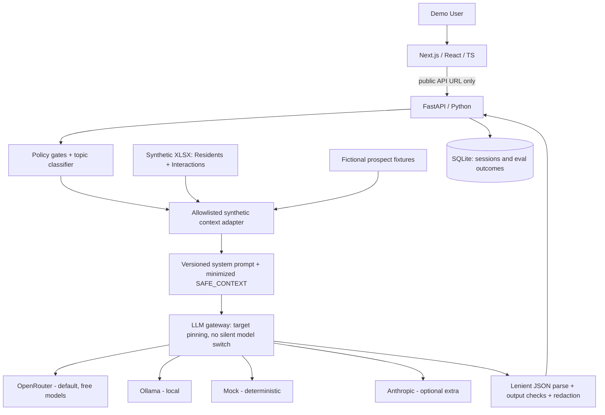

# MVP Architecture

> **Updated 2026-11-05 (pipeline v2).** The chat path now runs a 10-step pipeline with a typed decision gate, workflow selection and structured handoff recommendations. Current, code-verified diagrams: [architecture](diagrams/architecture.md) · [conversation flow](diagrams/conversation-flow.md) · [sequence](diagrams/sequence.md) · [data flow](diagrams/data-flow.md). Design notes: [GATE_DESIGN.md](GATE_DESIGN.md), [DECISIONS.md](DECISIONS.md), [WORKFLOW_REVIEW.md](WORKFLOW_REVIEW.md). The overview diagram below is the original v1 summary.



## Repo layout
```
frontend/                      # Next.js app router
  src/lib/api.ts, types.ts     # typed client mirroring backend contracts (no secrets)
  src/components/mckinley/     # AppShell, ChatWorkbench, ContextPreview, ResponseDetails, EvalDashboard
backend/
  app/main.py                  # FastAPI app, health, model targets, CORS for dev origins only
  app/api/chat.py              # personas, context preview, POST /api/chat
  app/api/evals.py             # cases, run, results, review, summary, runs
  app/models.py                # Pydantic API contracts
  app/context.py               # XLSX import/validation + safe context extraction
  app/personas.py              # fictional prospects, unmatched resident, workbook personas
  app/prompts.py               # prompt/version loader, baseline prompt, message assembly
  app/safety.py                # redaction, injection screen, policy gates, output checks
  app/chat_engine.py           # one turn: context -> gates -> LLM -> checks -> handoff merge
  app/evals.py, run_evals.py   # five-case harness, provisional grader, export, CLI
  app/llm/                     # provider-agnostic layer (knows nothing about residents)
    base.py                    # Target, GenerationConfig, LLMResult, LLMError, schema, lenient parser
    http.py                    # shared HTTP POST with bounded same-model retries and error mapping
    openrouter.py, ollama.py, mock.py, anthropic_provider.py
    __init__.py                # registry (FACTORIES) + LLMGateway
  data/                        # synthetic XLSX + SQLite (gitignored)
  tests/
```

## Endpoint contracts
- `GET /api/health`: default provider/model, readiness (`NEEDS_API_KEY` etc.), prompt version, workbook status.
- `GET /api/models`: server-configured `provider:model` targets with readiness. No keys or base URLs.
- `GET /api/personas`: safe synthetic persona IDs/labels only.
- `POST /api/context/preview` `{persona_id, message}`: exactly the SAFE_CONTEXT aware mode would send.
- `POST /api/chat` `{message, persona_id?, mode: "baseline"|"aware", session_id?, target?}` returns `{reply, audience, recommended_handoff, handoff_reason, handoff_category, handoff_is_recommendation_only, model_handoff, policy_signals, output_checks, source_context_fields, provider, requested_model, model, is_mock, parse_mode, temperature, prompt_version, usage, latency_ms, ...}`. Errors come back as `{error: {code, message, retryable}}` with codes such as `NEEDS_API_KEY`, `MODEL_RATE_LIMITED`, `MODEL_TIMEOUT`, `MODEL_NOT_FOUND`, `MODEL_SWITCHED`, `UNKNOWN_TARGET`.
- `GET /api/gates/config` (configured gate + availability), `GET /api/gates/scenarios`, `POST /api/gates/evaluate` `{providers: ["rules"|"llm"|"jev"]}` (routing-only comparison), `GET /api/gates/log` (routing metadata, hashed session, no message text).
- `POST /api/chat` also accepts `mode: "prompt_only"` and `gate_provider`, and returns `safety_notice`, `gate`, `workflow`, `maintenance`, `lead`, `renewal`, `handoff`, `pipeline`.
- `GET /api/evals/cases`, `POST /api/evals/run` `{targets?, case_ids?, modes?}` (sequential), `GET /api/evals/results?run_id`, `PATCH /api/evals/results/{id}` `{human_verdict, human_notes}`, `GET /api/evals/summary?run_id`, `GET /api/evals/runs`.

## LLM provider abstraction
- **Contract:** `LLMProvider.complete(system, messages, target, cfg) -> LLMResult`. Providers receive only a system prompt and chat messages. They have no access to the workbook, personas or policy code. This keeps synthetic resident data handling separate from vendor adapters.
- **Targets:** a `Target` is an explicit `provider:model` pair. Chat uses `LLM_PROVIDER`/`LLM_MODEL` unless the UI picks another target from `EVAL_TARGETS`. The server rejects arbitrary targets from the browser.
- **No silent switching:** the OpenRouter request names a single model (no `models` fallback list, no auto-router). Retries on 429/5xx/timeouts reuse the same model with bounded backoff that honors `Retry-After`. The gateway compares the served model ID with the requested one (allowing `:free`/`:latest` and dated-snapshot suffixes). On mismatch it raises `MODEL_SWITCHED` and the result is discarded rather than recorded under the wrong model.
- **Structured output:** every provider is asked for the same JSON schema (OpenRouter `response_format: json_schema`, Ollama `format`, Anthropic `output_config.format`). Free and local models often ignore it, so parsing is lenient: plain JSON, then JSON extracted from prose or code fences, then `text_fallback`, where the raw text becomes the reply with no model handoff signal. The parse mode is recorded and shown, and `text_fallback` fails the `structured_output` check.
- **Generation settings** (`LLM_TEMPERATURE`, `LLM_MAX_TOKENS`, `LLM_TIMEOUT_SECONDS`, `LLM_MAX_RETRIES`) are identical for baseline and aware modes. Anthropic's current models reject temperature, so it records `temperature: null` and uses `ANTHROPIC_EFFORT`.
- **Mock provider:** rule-based templates, deterministic latency/tokens, `is_mock=true`, labelled MOCK in the UI and in exports. It exists to exercise the harness and UI, and is never evidence of model quality.
- **Adding a provider** (Gemini, Groq, etc.): implement `complete()` in `app/llm/<name>.py`, register a factory in `app/llm/__init__.py:FACTORIES`, add a key to `Settings.api_key_for` and any readiness logic to `provider_ready`. Groq and many others are OpenAI-compatible and can reuse the OpenRouter adapter's shape.

## Context adapter
- Workbook tabs: README; Residents (20 rows, 31 fields); Interactions (101 rows, 10 fields). Required sheets/columns are validated, missing values are normalized to empty, and orphan interactions are ignored with a warning.
- Join on `resident_id`; normalize strings/dates; keep provenance (`Residents.preferred_contact`, `Interactions[I003]`).
- Send only what is minimally necessary: first name, community, tenure band, preferred language/channel, plus topic-gated fields: renewal status for renewal topics, open requests/entry window for maintenance topics, and the contact-timing clause of `notes_for_staff` for contact, renewal or maintenance topics. Related history is summarized from category/subject/status/follow-up columns only. Derived flags: `repeat_issue_flag` (2+ related maintenance contacts) and `open_commitment_flag`.
- Never forwarded: last name, email, phone, `unit_type`, rent, balance, late payments, autopay, household, pets, vehicles, lead source, entry permission, raw `notes_for_staff`, `full_text`.
- Free-text values pass an instruction-injection screen and are redacted and length-capped. Dropped items are listed in the Context Preview.
- Prospects: no prospect dataset was supplied, so prospects are clearly labelled fictional fixtures with no live inventory or pricing.

## Safety layers
1. **Input:** the user message is redacted and stripped of delimiter tags, then wrapped as `<customer_message>`. Context goes in `<safe_context>` marked as data.
2. **Pre-model policy gates** (regex, auditable): emergency hazard, human requested, sensitive data request, fair-housing/legal/accommodation, financial/lease, voucher eligibility, repeat language.
3. **Handoff merge (aware mode):** final recommendation = model recommendation OR always-escalate gates OR context flags. Baseline reports only the model's own recommendation, since it represents generic, unlayered behavior. Handoff is always labelled *recommendation only*.
4. **Output checks:** terminology (beds/floor plans), false action claims, prices/clock times not in verified context, PII, risky DIY, JSON contract. Replies are redacted before display and rendered as plain text.

## Evaluation
Five cases × {baseline, aware} × selected targets, run sequentially. The provisional grader maps the five rubric criteria to automated checks or heuristics; criteria that need judgment are marked `null` for human review. Critical failures (PII, false action claims, risky DIY) force BAD. Human Good/Bad + notes override provisional verdicts. The summary groups by target × mode: good/bad, errors, human-reviewed, handoffs, JSON failures, average latency, tokens and cost.

## Architectural decisions (MVP)
- **Provider-agnostic gateway over a vendor SDK:** OpenRouter and Ollama use plain HTTP via `httpx`. The Anthropic SDK is an optional extra, so nothing requires a paid key.
- **Direct browser → FastAPI over CORS** instead of a Next.js proxy, so long eval runs avoid dev-proxy timeouts. Only the public base URL is exposed to the browser.
- **Deterministic safety alongside prompting:** regex gates and checks are simple, testable and visible in the UI. They supplement model judgment and do not by themselves guarantee fair-housing compliance.
- **SQLite + JSON export:** enough for demo sessions and eval history, with no infrastructure.

## Security and governance
Server-side keys only (`backend/.env`, gitignored); request validation (`extra="forbid"`, length limits); restricted CORS; model output treated as untrusted text; logs contain status/latency/token counts only, never message content or keys; no external writes. Free hosted models may log prompts, so only synthetic or de-identified data is allowed. Production would additionally require authentication, RBAC, audit logs, retention controls, encryption, rate limits, vendor/legal review (including provider data-use terms) and documented data access contracts.

## Future integration, NOT MVP
Yardi Voyager / RentCafe -> authorized Databricks replica (Joshua says ~10-minute delay) -> least-privilege data gateway -> context engine -> channels (web, phone, email, SMS). Live lookups and write actions need separate permissions and robust reconciliation. For maintenance emergencies, route to actual emergency channels, not unsupported self-service instructions.
