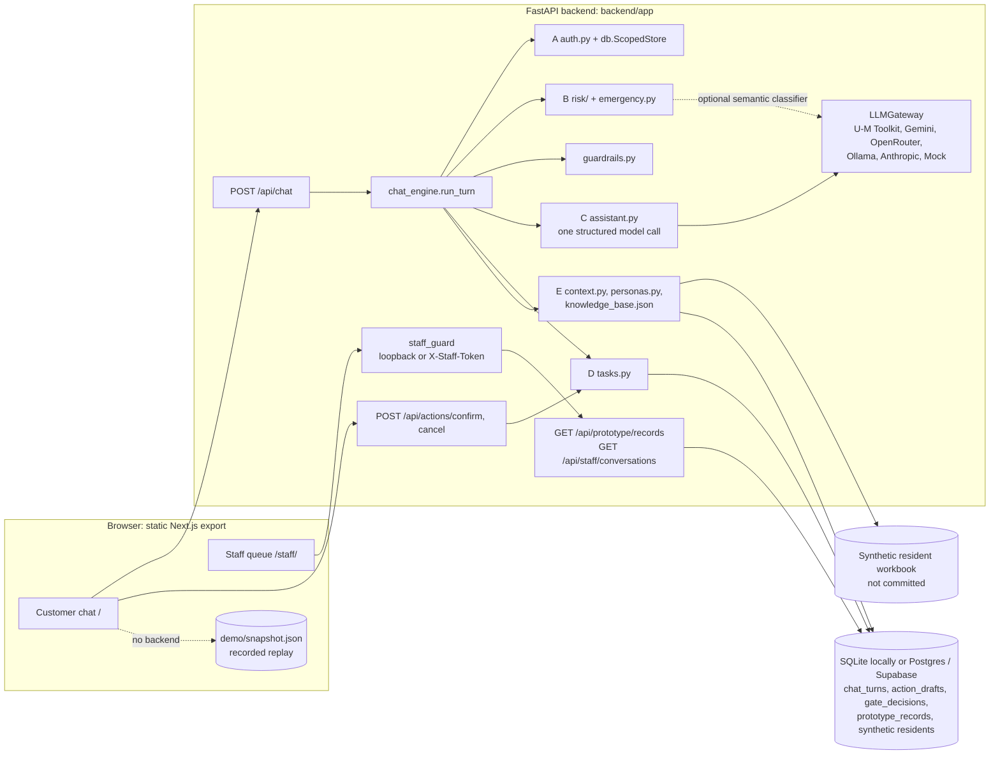
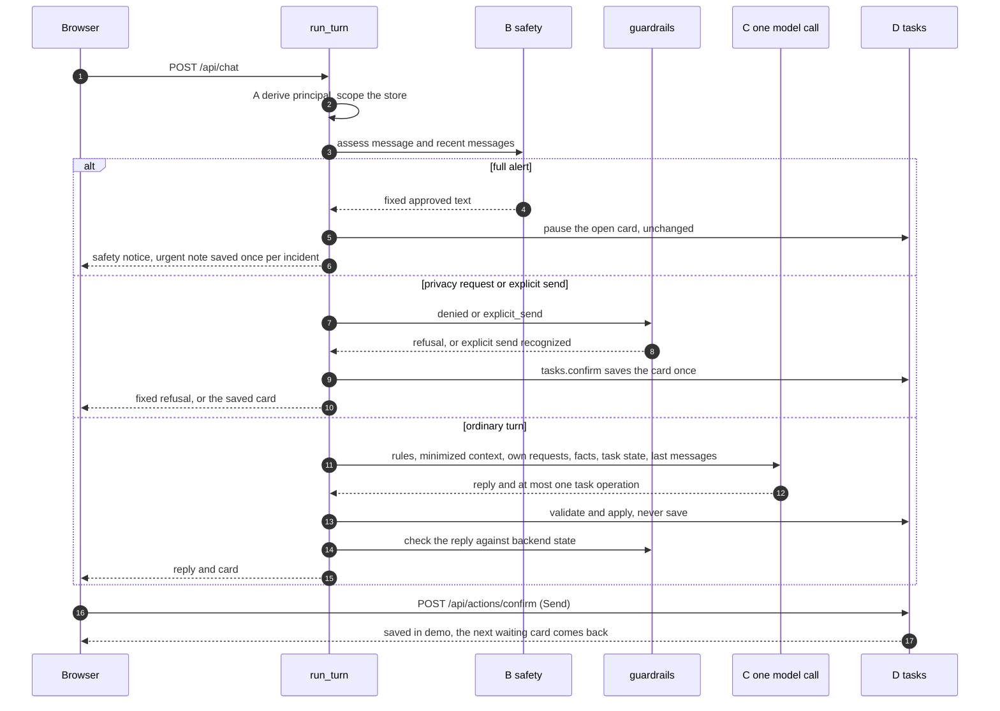

# Architecture

The McKinley assistant is a **prototype on synthetic data**: a chat for residents, prospective renters and visitors,
plus a staff queue. Nothing connects to Yardi, a CRM, a pager, SMS/email or a work-order system; "saved" means saved
to a labelled prototype table. Deployment: [DEPLOYMENT.md](DEPLOYMENT.md). Who can see what: [SECURITY.md](SECURITY.md).
How it is tested and the latest results: [TESTING.md](TESTING.md).

## System

| Part | Where |
| --- | --- |
| Customer chat (cards, safety notices, demo sign-in picker) | `frontend/src/components/customer/` |
| Staff queue (saved requests, live conversations; staff token on a shared site) | `frontend/src/components/staff/` |
| Static replay for the here.now preview (no backend) | `frontend/public/demo/snapshot.json`, built by `backend/app/export_demo.py` |
| API routes, one error envelope `{"error": {code, message, retryable}}` | `backend/app/main.py`, `backend/app/api/` |
| Persistence and migrations; synthetic seed | `backend/app/db.py`, `backend/migrations/`, `backend/app/seed_synthetic.py` |
| Manual, budgeted provider checks (never imported by the app) | `backend/app/live_eval/` |

## One chat turn: five parts, always in this order

`backend/app/chat_engine.py` (`run_turn`):

| Part | Code | What it does |
| --- | --- | --- |
| **A. Identity** | `auth.py`, `db.ScopedStore` | Derives the principal server-side (anonymous, or a demo persona when the deployment allows it). Message text and the model never change it. Every read and write goes through a store scoped to this session and principal. |
| **B. Safety** | `risk/`, `emergency.py` | Runs on **every** message first: deterministic rules → optional semantic classifier → policy → fixed approved text. An emergency gets the approved instructions, one urgent prototype note per incident, pauses the open task, and makes **no** conversation model call. |
| **C. Conversation** | `guardrails.py`, `assistant.py` | Privacy refusals (another resident's data, a claimed other identity or resident id, a claimed staff/admin role), explicit typed sends, and consent to keep a possible duplicate as a separate request are decided first, deterministically. Otherwise **one** structured model call (schema `mckinley_assistant`) returns a reply plus at most one proposed task operation. |
| **D. Tasks** | `tasks.py` | The only owner of task state: one **active** card plus a **waiting** list. `start`, `update`, `suspend`, `resume`, `cancel` are validated here. **Save happens only through `confirm`**: the Send button or an explicit "send it". Pressing Send twice returns the same record (`ALREADY_SAVED`). |
| **E. Tools and checks** | `tasks.my_requests`, `tasks.history_lines`, `personas.py`, `context.py`, `content/knowledge_base.json` | The person's own requests and history, minimized authorized context, approved property facts. Every model reply is checked (`guardrails.unsupported_claims` + output checks): a claim that something was saved, an identity change, an unknown reference or history not on record is replaced by the backend's own plain sentence. |

### Cards (tasks)
| Card | Who | Fields |
| --- | --- | --- |
| `maintenance_request` | signed-in demo resident | `issue`, `location`, `entry` (+ `history`: an open related request from their record, filled by the backend) |
| `tour_request` | anyone | `area`, `days`, `time` (`beds`, `move_in` optional) |
| `staff_handoff` | anyone: a person asked for, a question only staff can answer, **a visitor's repair** (then `community` + `unit` are required before Send) | `topic`, `message`, `community`, `unit`, `earlier` (the task they came from), `history` (the signed-in resident's related requests, built from their record, never written by the model) |

## Safety pipeline (`backend/app/risk/`)
1. **Deterministic rules** (`risk/detect.py` wrapping `emergency.scan`): hazard vocabulary and meaning-level concepts,
   framing (hypothetical, past, negated, figurative), a short conversation window.
2. **Semantic classifier** (`risk/classifier.py`, optional, `SAFETY_CLASSIFIER=auto`): one structured call on the
   configured model with the last message and up to three earlier customer messages (never resident records). It can
   only **add** caution; a failed call never makes a turn "safe" (recorded as `degraded`).
3. **Policy** (`risk/policy.py`, in code order; the first rule that fires decides): R1 deterministic emergency → full
   alert; R2 semantic emergency → full alert; R3 "joking" self-harm → 988 line; R4u semantic "uncertain" with no
   category → 911 care line; R4 semantic urgent / uncertain with a category → that category's care line; R5 / R5p /
   R5c hypothetical, past, or conditional hazard → calm safety info; R6 distress / unwell → that care line; R9e new
   danger words after a person-danger alert → full alert again; R4b the provider's content filter refused the
   message **and** the rules or an earlier person-danger alert show a sign of danger → calm line (988 for distress or
   self-harm, else 911) plus a staff check; R4n the same refusal with no sign → no safety text (a filter alone is not
   evidence of danger); R7 danger vocabulary → 911 care line; R9 a person-danger alert earlier in the chat → keep a
   calm line; R8 nothing.
4. **Incident state** (`risk/incident.py`, stored as `gate_decisions` rows with mode `safety_incident`, no message
   text): an active incident repeats the alert for follow-ups (R10) and keeps a calm line on quiet turns (R10q). It
   closes on a responder-grounded resolution ("the gas company fixed the leak", R10r), an explicit retraction, the
   hazard reported under control (for example the water shut off), the person safe and on another topic, or after 3
   quiet turns; a self-harm incident is never closed by these. Vague reassurance ("it's fine now") never closes it,
   and a resolution or "under control" claim does not count when the same message says the danger is still there
   ("fixed, but I still smell gas", "the smell came back", "he's still outside"). A new report after closing opens a new incident (and a
   new urgent note).
5. **Approved text** (constants in `emergency.py`, chosen by `risk/responses.py`): fixed team-draft wording (911 / 988 / gas company / Poison Help /
   maintenance line). The model never writes safety text. McKinley has **not** approved these scripts.

## Context and data
- Synthetic workbook tabs Residents and Interactions, joined on `resident_id` (locally from the git-ignored XLSX; on a
  hosted backend from the database after `python -m app.seed_synthetic`, which refuses non-synthetic workbooks).
- The model receives only allowlisted fields: first name, community, tenure band, preferred language/channel and
  topic-gated items (renewal status, open requests and the preferred entry window, a contact-timing clause from staff
  notes, related history summarized from category/subject/status with counts and repeat / open-commitment flags).
  Never: last name,
  email, phone, rent, balances, household, pets, vehicles, entry permission, raw staff notes, full transcripts. Free
  text is screened for injected instructions, redacted and length-capped.

## Model providers (`backend/app/llm/`)
One gateway, one explicit `provider:model` per request (`LLM_PROVIDER`, `LLM_MODEL`); providers receive only a system
prompt and messages. Same-model retries only; a different served model is rejected (`MODEL_SWITCHED`). A failed call
never changes task state. Timeouts, rate limits, bad or empty output and a provider **content-filter** rejection
(`MODEL_CONTENT_FILTERED`: an HTTP 400/403 whose provider error text names the content filter or moderation) get a
fixed "say it another way" line (`FALLBACK_CODES` in `chat_engine.py`); any other provider error (an authentication
or key problem, another 400) ends the turn with HTTP 503 "The assistant is not available right now". A turn that
already shows safety text never becomes an error: whatever the model does, it keeps the approved notice plus a fixed
line, and no second model call is made for emergency guidance. Gemini and Anthropic safety blocks still map to
`MODEL_REFUSAL`, not to the content-filter code. The **mock** provider
is a keyword stand-in for offline tests and the replay, always labelled MOCK, never evidence of conversation quality.

## Key decisions
| Decision | Why |
| --- | --- |
| One model call per ordinary turn + a deterministic task controller (the 2026-11 MVP reset replaced an ordered planner, decision gates and an understanding layer) | One owner per concern; the model proposes, the backend decides; consent, privacy and safety stay testable offline |
| Deterministic safety first, semantic layer may only add caution | A model outage or mistake can never remove emergency guidance |
| Fixed, approved safety wording | Safety text must be reviewable and identical every time |
| Prototype store instead of integrations | Honest demo: nothing pretends to reach staff or Yardi |
| Direct browser → FastAPI over CORS; static website | No server code on the website hosts; only the public backend address is in the build |
| Provider-agnostic gateway over plain HTTP | No vendor SDK or key is a hard dependency |
| Build vs buy is **still open** | The prototype tests one option: a thin, owned context-and-policy layer on a frontier model. Before production, compare (a) existing Yardi, (b) a vendor add-on, (c) this thin layer / hybrid, (d) full in-house, with real costs and ownership risk. Gates: prototype (quality, privacy, staff review) → limited pilot (legal/security review, rollback, logs, KPIs) → production (auth, access control, real integrations, monitoring, audit) |

## Not in the MVP
Phone/voice, SMS/email channel rules, vendor callers, real sign-in, live Yardi/Databricks lookups, paging, work-order
creation, scheduling. Future path: Yardi / RentCafe → authorized Databricks replica → least-privilege data gateway →
this context engine → channels; emergencies must route to real emergency channels.
