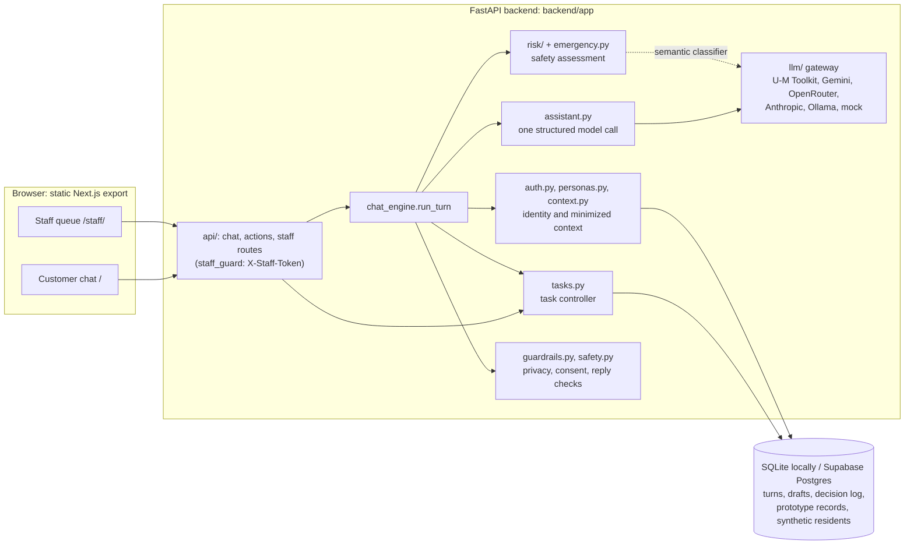

# Architecture

A chat for residents, prospective renters and visitors, plus a staff queue. It is a **prototype on synthetic data**:
nothing connects to Yardi, a CRM, a pager, SMS/email or a work-order system, and "saved" means saved to a labelled
prototype table.

**Design principle: the LLM understands and proposes; the backend authorizes, enforces policy, manages state and
persists.** There is one structured model call per ordinary turn, not a planner or a set of agents.

Related: deployment in [DEPLOYMENT.md](DEPLOYMENT.md), security boundaries in [SECURITY.md](SECURITY.md), tests in
[TESTING.md](TESTING.md).

## System

| Component | Where | Responsibility |
| --- | --- | --- |
| Website | `frontend/src/components/customer/`, `staff/` | Chat, read-back cards, safety notices, demo persona picker; staff queue |
| API | `backend/app/main.py`, `backend/app/api/` | Routes, one error envelope `{"error": {code, message, retryable}}`, staff guard, rate limits |
| Turn engine | `backend/app/chat_engine.py` | Runs one chat turn in fixed steps (below) |
| Identity and context | `auth.py`, `personas.py`, `context.py`, `db.ScopedStore` | Who is asking (server-side only) and the minimized context they may see |
| Safety | `backend/app/risk/`, `emergency.py` | Assesses every message before anything else; chooses fixed approved wording |
| Conversation | `assistant.py` (`RULES`, `ask`) | The one structured model call: a reply plus at most one proposed task operation |
| Task controller | `tasks.py` | The only owner of task state and the only path that saves a record |
| Guards | `guardrails.py`, `safety.py` | Privacy refusals, explicit send, reply checks, the legal referral, redaction |
| Model gateway | `backend/app/llm/` | One explicit `provider:model`; same-model retries only |
| Persistence | `db.py`, `backend/migrations/` | Turns, drafts, decision log, prototype records, synthetic residents |
| Tools (not imported by the app) | `live_eval/`, `export_demo.py`, `seed_synthetic.py` | Provider preflight, here.now replay snapshot, synthetic seed |

## One chat turn

`run_turn` calls these steps in order. They share one per-turn record (`_Turn`).

| Step | Function | What happens |
| --- | --- | --- |
| 1. Identity and context | `_prepare` | Derive the principal on the server; the message text and the model never change it. Bind the session and scope the store to it. Build the minimized context. |
| 2. Safety | `_assess_safety`, `_start_reply` | Rules, then the semantic classifier, then the policy, then the incident state. Select the fixed safety wording for this turn. |
| 3a. Emergency | `_emergency_turn` | Show the approved notice, save one urgent prototype note per incident, and pause the open card unchanged. **No model call.** |
| 3b. Backend-only reply | `_backend_reply` | Privacy refusal; consent to keep a possible duplicate as a separate request; an explicit typed send ("send it"): saved if the card is complete, otherwise what's missing is listed. |
| 3c. Model turn | `_model_turn` | One structured model call. The task controller validates and applies its proposed operation; it never saves. |
| 4. Validation | `_validate` | Check the reply against backend state. Unsupported claims are replaced by the backend's own sentence; a legal determination is replaced by the referral, always. |
| 5. Persistence | `_persist`, `_response` | Save the task state if it changed, the turn, and a decision log of codes only, never message text. Build the API response. |

Saving happens only through `tasks.confirm`, after the Send button or an explicit typed send. A repeated Send returns
the record already saved (`ALREADY_SAVED`), and Send never saves a card that isn't on screen.

### Cards

There is one active card plus a waiting list; a second request waits as its own card.

| Card | Who | Required before Send |
| --- | --- | --- |
| `maintenance_request` | Signed-in demo resident | `issue`, `location`, `entry` |
| `tour_request` | Anyone | `area`, `days`, `time` |
| `staff_handoff` (note for the office) | Anyone | `message`; a visitor's repair also needs `community` and `unit` |

## Identity and scoped data

- **Principals:** `anonymous`, `demo_persona` (only where the deployment allows demo personas) and `staff` (staff
  token). Real resident sign-in does not exist.
- **Scoped store:** every read and write in a turn goes through a store bound to this session and principal.
- **What the model sees:** an allowlisted summary of the person's own record, never contact details, rent,
  balances, entry permission, raw staff notes or transcripts.
- **History:** related history is the person's own items about the same thing (`context.related_interactions`).

Details: [SECURITY.md](SECURITY.md).

## Safety assessment (safety pipeline)

1. **Rules** (`risk/detect.py`, `emergency.py`): hazard and self-harm wording, framing (hypothetical, past,
   figurative) and a short conversation window.
2. **Semantic classifier** (`risk/classifier.py`, `SAFETY_CLASSIFIER=auto`): one structured call on recent customer
   messages only. It can only **add** caution, and a failed call never makes a turn "safe".
3. **Policy** (`risk/policy.py`): an ordered rule list. Its docstring is the canonical table. A rules alert or a rule
   care line is never removed by the classifier.
4. **Incident state** (`risk/incident.py`): an emergency continues across turns until a grounded resolution. Vague
   reassurance never closes it, and a self-harm incident is never closed by these rules.
5. **Wording** (`emergency.py`, `risk/responses.py`): fixed team-draft text (911, 988, gas company, Poison Help,
   maintenance line). The model never writes safety text, and McKinley has **not** approved it.

The rules-first design produces false alarms (see [HANDOFF.md](HANDOFF.md#known-issues)). An alternative policy that
lets the classifier correct low-precision lines exists **offline only**, in `backend/experiments/` (not imported by
the app).

## Model gateway

- **Model choice:** one gateway, with one explicit `provider:model` per deployment (`LLM_PROVIDER`, `LLM_MODEL`).
- **Retries and failures:** retries reuse the same model; a different served model is rejected (`MODEL_SWITCHED`),
  and there is no silent fallback to another model or the mock. A failed call never changes task state.
- **What the customer sees:** timeouts, rate limits, bad output and provider content-filter rejections get a fixed
  "say it another way" line. Other provider errors return HTTP 503. A turn that already shows safety text keeps it,
  whatever the model does.
- **The mock provider** is a keyword stand-in for offline tests, always labelled MOCK, and never evidence of
  conversation quality.

## Key decisions

| Decision | Why |
| --- | --- |
| One model call plus a deterministic task controller (the 2026-11 MVP reset replaced a planner, decision gates and an understanding layer) | One owner per concern; consent, privacy and safety stay testable offline |
| Safety before the model; the classifier may only add caution | A model outage or mistake can't remove emergency guidance |
| Fixed safety wording | Reviewable and identical every time |
| Prototype store, no integrations | Nothing pretends to reach staff, responders or Yardi |
| Static website, browser calls the API over CORS | No server code or secrets on the website host |
| Provider-agnostic gateway over plain HTTP | No vendor SDK or key is a hard dependency |
| Build vs buy is still open | The prototype tests a thin, owned context-and-policy layer. Before production, compare Yardi's own tools, a vendor add-on, this layer and a full build. |

## Not built

- **Channels and identity:** phone and voice, SMS/email channel rules, real sign-in.
- **Data and integrations:** live Yardi or Databricks data, paging, work orders, scheduling.
- **A possible production path:** Yardi / RentCafe → an authorized Databricks replica → a least-privilege data
  gateway → this context engine → channels. Emergencies must reach real emergency channels.
