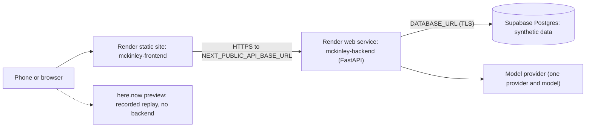

# Deployment and configuration

How the prototype runs locally and on Render with Supabase, which settings matter, and how to check a deploy. It is
a **prototype on synthetic data, not a production service**.

**Ground rules:**
- **Secrets:** never put a key, database URL or staff token in the website, the repository, a pull request or a chat
  (the repository is public).
- **Production and the dev site:** they deploy only from GitHub Actions. Ross IT owns `scripts/` and `.github/`
  ([CLAUDE.md](../CLAUDE.md)).

## 1. What runs where

- **The website** is a static export with no server code and no secrets. The browser calls the backend directly, and
  only the backend talks to the database and the model.
- **Render** deploys both services automatically from `development`. Vercel (`frontend/vercel.json`) is a supported
  alternative for the website; use one website host per backend.

## 2. Environments

| Environment | What you get | How |
| --- | --- | --- |
| Local | The full app, a SQLite file, any provider (or the mock) | [README](../README.md#run-locally) |
| here.now preview | A static replay of recorded conversations; typing is off | `npm run publish:preview` ([CLAUDE.md](../CLAUDE.md)) |
| Render | Live chat against the Render backend and Supabase | auto-deploy from `development` |

**Local defaults:** `/docs` is open, demo personas are on, and staff routes answer requests from the same machine
without a token.

**The here.now preview** is built without `NEXT_PUBLIC_API_BASE_URL`, so it replays
`frontend/public/demo/snapshot.json` (built by `backend/app/export_demo.py`). It is a showcase, not evidence that live
chat works.

**Render: last observed state** (2026-11-16, from `/api/health` and one synthetic chat turn; the Dashboard itself was
not read):
- **Model:** U-M GPT Toolkit `gpt-6.1-sol` (served `gpt-6.1-sol-2026-09-29`).
- **Settings:** `APP_ENV=local` and `DEMO_PERSONAS_ENABLED=true`, for the sample-resident switcher.
- **Effect:** the hosted protections are **off**. `/docs`, `/openapi.json` and `/api/models` are public, rate limits
  are off, and the **Toolkit approval check doesn't run**. Staff routes still need the token, because Render's proxy
  makes every request non-local.

**Render: intended configuration** (`render.yaml`):
- `APP_ENV=hosted`, with demo personas off;
- `LLM_PROVIDER=um_toolkit`, with `LLM_MODEL` and `UM_TOOLKIT_MODEL` both `gpt-6.1-sol`, and the safety classifier on
  the same model;
- `RESIDENT_DATA_SOURCE=database`, a generated `STAFF_API_TOKEN`, and exact `https` `CORS_ORIGINS`;
- no other provider and no fallback model.

The live service takes its values from Render's Environment page. `render.yaml` applies only when a Blueprint is
created or synced.

> **Blocking prerequisite: U-M Toolkit on a public site.** `UM_TOOLKIT_HOSTED_APPROVED` must stay unset until the
> university confirms **in writing** that the Toolkit key may serve a public website. Until then the hosted
> configuration **refuses to start** (by design). A working `APP_ENV=local` deployment is **not** that confirmation.
> That confirmation has not been given.

**Demo personas on a hosted backend** need a code change that hasn't been built: allow the synthetic switcher while
keeping every other hosted check. Until then, don't weaken `hosted_problems` ad hoc.

## 3. Backend settings

Locally the settings go in `backend/.env`; on Render, in the Environment page. Every setting is in `Settings`
(`backend/app/config.py`); common ones are commented in `backend/.env.example`.

| Setting | Purpose | When `APP_ENV=hosted` | Secret |
| --- | --- | --- | --- |
| `APP_ENV` | `local` or `hosted` (turns on the checks and protections) | `hosted` | no |
| `DEMO_PERSONAS_ENABLED` | Sample-resident switcher; empty = on locally | must not be `true` | no |
| `KNOWLEDGE_CONTENT_MODE` | `approved_only` or `demo_samples` (labelled made-up answers) | `approved_only` | no |
| `LLM_PROVIDER` / `LLM_MODEL` | The one chat provider and model | provider must be explicit; its key must be set | no |
| `UM_TOOLKIT_API_KEY` / `UM_TOOLKIT_MODEL` / `UM_TOOLKIT_BASE_URL` | U-M GPT Toolkit (default model `gpt-6.1-sol`) | refused without approval | key yes |
| `UM_TOOLKIT_HOSTED_APPROVED` | `true` **only** after written university confirmation | see section 2 | no |
| `OPENROUTER_API_KEY`, `GEMINI_API_KEY` (+ `GEMINI_MODEL`, `GEMINI_BASE_URL`), `ANTHROPIC_API_KEY`, `OLLAMA_BASE_URL` | Other providers | base URLs must be `https` | keys yes |
| `SAFETY_CLASSIFIER` / `SAFETY_CLASSIFIER_TARGET` / `SAFETY_CLASSIFIER_TIMEOUT_SECONDS` | Semantic safety check (`auto` / `off`); empty target = the chat model | — | no |
| `LLM_TIMEOUT_SECONDS`, `LLM_MAX_RETRIES`, `LLM_CALL_BUDGET`, `LLM_CALL_LEDGER` | Limits; a per-process call cap; a metadata-only call log | `render.yaml`: 25 s, 1 retry, 1500 calls | no |
| `RATE_LIMIT_PER_MINUTE` / `RATE_LIMIT_PER_SESSION_MINUTE` / `MAX_REQUEST_BYTES` | Empty = 30/15 per minute when hosted, off locally; 64 KB bodies | defaults apply | no |
| `EVAL_TARGETS` | `provider:model` list for staff | no `um_toolkit:` without approval | no |
| `STAFF_API_TOKEN` | Unlocks staff routes (`X-Staff-Token`) | 24+ random characters | **yes** |
| `DATABASE_URL` | Postgres (Supabase Session pooler); empty = SQLite at `DB_PATH` | required | **yes** |
| `RESIDENT_DATA_SOURCE` | `auto`, `file` or `database` | set `database` (no workbook on Render) | no |
| `CORS_ORIGINS` | Exact website address(es), comma-separated, no path | exact `https` origins | no |

**A hosted start is refused** (`Settings.hosted_problems`; the messages never print values) if:
- `CORS_ORIGINS` is missing, a wildcard, localhost, `http`, or has a path;
- `STAFF_API_TOKEN` is weak or missing;
- `KNOWLEDGE_CONTENT_MODE=demo_samples` or `DEMO_PERSONAS_ENABLED=true`;
- `LLM_PROVIDER` isn't explicit, or the provider's key is missing;
- the Toolkit is used without `UM_TOOLKIT_HOSTED_APPROVED=true`;
- a provider base URL isn't `https`;
- `DATABASE_URL` is empty.

A refused start leaves the previous deploy serving.

**On any start:** `LLM_PROVIDER=um_toolkit` with an OpenRouter-style `LLM_MODEL` (containing `/` or ending `:free`)
is refused.

## 4. Website build

| Setting | Value | Secret |
| --- | --- | --- |
| `NEXT_PUBLIC_API_BASE_URL` | The backend's `https` address, no trailing slash; empty = the here.now replay | **no**: built into the public JavaScript |
| `NEXT_STATIC_EXPORT` | `1` = static export into `frontend/out/` | no |
| `NODE_VERSION` | `22` (Render static site) | no |

`NEXT_PUBLIC_*` values are read **at build time**: after changing the backend address, redeploy the website.

**Render static site:** root `frontend`, build `npm ci && NEXT_STATIC_EXPORT=1 npm run build`, publish `out`.

**Vercel:** Root Directory `frontend`; add its exact address to `CORS_ORIGINS`. Both hosts add the same security
headers.

## 5. Database
- **Migrations:** in `backend/migrations/versions/` (`0001`–`0004`). Run `uv run alembic upgrade head`; Render runs it
  before every start. Never run `alembic downgrade` on a shared database.
- **Postgres:** uses TLS for any non-local host. Row-level security is on for every table with no policies, and the
  `anon`/`authenticated` privileges are revoked, so Supabase's public API reads nothing. Don't add policies without
  real authentication.
- **Synthetic seed:** run `uv run python -m app.seed_synthetic` (`--dry-run` to count only) with `DATABASE_URL` in
  `backend/.env`, then restart the backend. It refuses a workbook not marked synthetic. Never load real McKinley data.
- **Postgres tests** use `TEST_DATABASE_URL` and refuse a Supabase host or `DATABASE_URL` unless
  `ALLOW_DESTRUCTIVE_DB_TESTS=1` is set for a throwaway project.

Render runs one uvicorn process: rate limits and conversation locks are in memory.

## 6. Deploy checklist

**Before merging into `development`:**
- tests are green;
- Render has `DATABASE_URL`, the provider key and `STAFF_API_TOKEN`;
- `LLM_PROVIDER` is set explicitly;
- `CORS_ORIGINS` lists the website's exact address.

**After the auto-deploy:**
1. **Health:** `GET /api/health` shows `status: ok`, the expected `provider`, `model` and `app_env`,
   `provider_ready: true`, `is_mock: false`, and `commit` equal to the merged commit. One synthetic chat turn reports
   the served model.
2. **CORS:** the website's origin gets `access-control-allow-origin`; another origin doesn't.
3. **Chat on a phone:** a question, a follow-up, a tour request with a correction, then Send. Refresh and the
   conversation continues.
4. **Staff:** `/staff/` asks for the token; a wrong token is refused.
5. **Safety:** a synthetic gas-smell message gets emergency guidance.

## 7. Troubleshooting

| Symptom | Likely cause |
| --- | --- |
| The first visit takes about a minute | Render's free plan sleeps when idle; the website waits up to 90 s |
| The backend doesn't start after a deploy (the old version keeps serving) | A hosted check refused the settings; the log names the setting, never its value |
| `MODEL_SWITCHED` or "not available" errors | The provider served a different model than requested, or the key or model is wrong. Check without spending tokens: `cd backend && uv run python -m app.live_eval.preflight` |
| The website can't reach the backend | `NEXT_PUBLIC_API_BASE_URL` was wrong at build time, or `CORS_ORIGINS` lacks the exact origin |
| Staff page shows only the demo data | No token entered, or a different `STAFF_API_TOKEN` on the backend |
| Residents missing on Render | The synthetic seed wasn't run, or `RESIDENT_DATA_SOURCE` isn't `database` |
