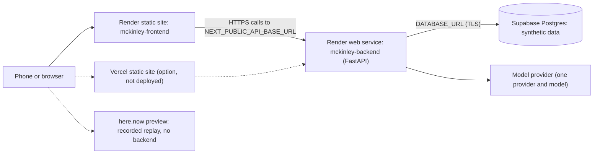

# Deployment guide

How the McKinley prototype is hosted today, how to run it, and how to check a deploy. It is a **prototype on
synthetic data, not a production service**. This guide replaces the older readiness, Render, Supabase, Vercel and
Gemini notes. Related: [README](../README.md), [architecture](ARCHITECTURE.md), [security](SECURITY.md),
[testing](TESTING.md), [handoff](HANDOFF.md), [CLAUDE.md](../CLAUDE.md), [render.yaml](../render.yaml),
[backend/.env.example](../backend/.env.example).

Ground rules: never put a key, database URL or staff token in the website, the repository, a pull request or a chat
(the repository is public). Never deploy production from a working session: the dev and public sites deploy only
from GitHub Actions, and Ross IT owns `scripts/` and `.github/`.

## 1. What runs where



The website is a **static export** (HTML and JavaScript only, no server code, no secrets). The browser calls the
backend directly; only the backend talks to the database and the model provider. Both Render services deploy
automatically from the `development` branch. Use one website host per backend (Render static site **or** Vercel).

## 2. Environments

| Environment | What you get | How |
| --- | --- | --- |
| Local | Full app, SQLite file database, any provider (or the mock) | commands below |
| here.now preview | Static replay of recorded conversations; typing is off and the page says so | `npm run publish:preview` |
| Render | Live chat against the Render backend and Supabase | auto-deploy from `development` |

**Local.** Copy `backend/.env.example` to `backend/.env` (git-ignored) and fill it in; `LLM_PROVIDER=mock` works
without any key.
```bash
cd backend && uv sync && uv run alembic upgrade head      # tables in data/mckinley_demo.sqlite3
npm run backend:dev                                        # from the repo root: API on http://localhost:8000
npm run dev                                                # website on http://localhost:3000
```
Locally `/docs` (API explorer) is open, demo sample residents are on, and staff routes answer requests from the same
machine without a token.

**here.now preview.** `npm run build` makes the static export in `dist/` and `npm run publish:preview` publishes
it (follow [CLAUDE.md](../CLAUDE.md) for sign-in and links). Built without `NEXT_PUBLIC_API_BASE_URL`, the site
never calls a backend: it replays recordings. It is a showcase, not evidence that live chat works.

**Render, current state (observed 2026-11-15).** For the short-term synthetic demo the backend runs with
`APP_ENV=local` and `DEMO_PERSONAS_ENABLED=true`, so the sample-resident switcher is on. Because `APP_ENV` is not
`hosted`, the hosted startup checks do not run, and: `/docs` and `/openapi.json` are public, `/api/models` is public,
the U-M GPT Toolkit approval check is skipped, and rate limits default to off. Staff routes still require
`STAFF_API_TOKEN`, because Render's proxy makes every request non-local. Switching to `APP_ENV=hosted` currently
refuses to start while `DEMO_PERSONAS_ENABLED=true` ("DEMO_PERSONAS_ENABLED must be false").

**Render, intended hosted configuration** (what `render.yaml` describes): `APP_ENV=hosted`, demo personas off,
an explicit `LLM_PROVIDER`, `DATABASE_URL` set, exact `https` `CORS_ORIGINS`, a generated `STAFF_API_TOKEN`. With
`APP_ENV=hosted` the backend **refuses to start** (`Settings.hosted_problems`, messages never print values) if:
CORS origins are missing, a wildcard, a path, localhost or `http`; `STAFF_API_TOKEN` is shorter than 24 characters
or not random-looking; `KNOWLEDGE_CONTENT_MODE=demo_samples`; `DEMO_PERSONAS_ENABLED=true`; `LLM_PROVIDER` is not set
explicitly; `um_toolkit` is used (as provider or in `EVAL_TARGETS`) without `UM_TOOLKIT_HOSTED_APPROVED=true`;
`GEMINI_BASE_URL` or `UM_TOOLKIT_BASE_URL` is not `https`; or `DATABASE_URL` is empty. A refused start leaves the
previous deploy serving. Hosted also hides `/docs`, `/redoc` and `/openapi.json`, returns an empty `/api/models` to
non-staff, turns on rate limits (30 requests a minute per visitor, 15 per conversation) and turns demo personas off.

Render runs `alembic upgrade head` before every start, then one uvicorn process (one instance: rate limits and
conversation locks are in memory). Health check: `GET /api/health`.

## 3. Backend settings

Set in Render's **Environment** page (the live service takes its values from there, not from `render.yaml`).
Locally in `backend/.env`. "Hosted" = required or checked when `APP_ENV=hosted`.

| Setting | Purpose | Hosted | Secret |
| --- | --- | --- | --- |
| `APP_ENV` | `local` or `hosted` (turns on the startup checks and protections above) | `hosted` | no |
| `DEMO_PERSONAS_ENABLED` | Sample-resident switcher; empty = on locally, always off when hosted | must not be `true` | no |
| `KNOWLEDGE_CONTENT_MODE` | `approved_only` or `demo_samples` (made-up sample answers) | `approved_only` | no |
| `LLM_PROVIDER` / `LLM_MODEL` | The one chat provider and model | provider must be explicit | no |
| `LLM_API_KEY` / `LLM_BASE_URL` | Generic key/address for the default provider (optional) | — | key yes |
| `OPENROUTER_API_KEY` | OpenRouter key | if OpenRouter is used | **yes** |
| `OPENROUTER_REASONING_EFFORT` | `none` turns reasoning off (faster replies) | optional | no |
| `GEMINI_API_KEY` / `GEMINI_MODEL` / `GEMINI_BASE_URL` / `GEMINI_THINKING_LEVEL` | Gemini direct or through a gateway | base URL must be `https` | key and URL yes |
| `UM_TOOLKIT_API_KEY` / `UM_TOOLKIT_MODEL` / `UM_TOOLKIT_BASE_URL` | U-M GPT Toolkit (default model `gpt-6.1-sol`) | refused unless approved | key yes |
| `UM_TOOLKIT_HOSTED_APPROVED` | Set `true` only after the university confirms public use | see section 7 | no |
| `ANTHROPIC_API_KEY` / `ANTHROPIC_EFFORT`, `OLLAMA_BASE_URL` | Other providers (local use) | — | key yes |
| `LLM_TEMPERATURE`, `LLM_MAX_TOKENS`, `LLM_TIMEOUT_SECONDS`, `LLM_MAX_RETRIES` | Generation limits; retries use the same model | optional | no |
| `LLM_CALL_BUDGET` / `LLM_CALL_LEDGER` | Cap on real model calls per process (0 = no cap); metadata-only log | `render.yaml`: 1500 | no |
| `RATE_LIMIT_PER_MINUTE` / `RATE_LIMIT_PER_SESSION_MINUTE` / `MAX_REQUEST_BYTES` | Empty = 30/15 when hosted, off locally; 0 = off; bodies over 64 KB get 413 | defaults apply | no |
| `EVAL_TARGETS` | `provider:model` list for the staff dashboard | no `um_toolkit:` unless approved | no |
| `STAFF_API_TOKEN` | Unlocks staff routes (`X-Staff-Token` header) | 24+ random characters | **yes** |
| `SAFETY_CLASSIFIER` / `SAFETY_CLASSIFIER_TARGET` / `SAFETY_CLASSIFIER_TIMEOUT_SECONDS` | Semantic safety check (`auto`/`off`); it only adds guidance | optional | no |
| `DATABASE_URL` | Postgres connection string (Supabase Session pooler) | required | **yes** |
| `DB_PATH` / `DATA_PATH` | Local SQLite file / synthetic workbook | — | no |
| `RESIDENT_DATA_SOURCE` | `auto`, `file` or `database` (Render: `database`) | not checked (set `database`: no XLSX on Render) | no |
| `CORS_ORIGINS` | Exact website address(es), comma-separated, no trailing path | exact `https` origins | no |

`GATE_OVERRIDE_ENABLED` is still listed in `render.yaml` but no longer has any effect. `RENDER_GIT_COMMIT` is set by
Render and shown as `commit` in `/api/health`.

## 4. Website build settings

| Setting | Value | Secret |
| --- | --- | --- |
| `NEXT_PUBLIC_API_BASE_URL` | The backend's `https` address, no trailing slash. Empty = here.now replay | **no**: built into the public JavaScript |
| `NEXT_STATIC_EXPORT` | `1` = static export into `frontend/out/` (with `trailingSlash`, so `/staff/` works) | no |
| `NODE_VERSION` | `22` (Render static site) | no |

`NEXT_PUBLIC_*` values are read **at build time**: after changing the backend address, redeploy the website. Never
put a key, database URL or the staff token in a `NEXT_PUBLIC_*` variable. Render static site: root `frontend`,
build `npm ci && NEXT_STATIC_EXPORT=1 npm run build`, publish `out`. Vercel option: Root Directory `frontend`,
everything else from `frontend/vercel.json`; add its exact address to `CORS_ORIGINS`. Both configs add the same
security headers (`X-Frame-Options: DENY`, `Referrer-Policy`, `Permissions-Policy`, `nosniff`).

## 5. Database

- `DATABASE_URL` set: Postgres through psycopg, with TLS required for any non-local host unless the URL sets
  `sslmode`. Empty: the local SQLite file `DB_PATH`. The browser never talks to the database.
- **Migrations** live in `backend/migrations/versions/` (`0001` baseline to `0004` session revocations). Run
  `uv run alembic upgrade head`; Render runs it on every start. Never run `alembic downgrade` on a shared database.
- **Row-level security** is on for every table with no policies, and `anon`/`authenticated` privileges are revoked,
  so Supabase's public Data API reads nothing. Views use `security_invoker` (Postgres 15+). Do not add policies
  without real authentication.
- **Synthetic seed.** Residents are read from the database at startup (the workbook is git-ignored and not on
  Render). From your machine, with `DATABASE_URL` in `backend/.env` (not on the command line):
  `uv run python -m app.seed_synthetic` (`--dry-run` to count only). It **refuses** any workbook whose README does
  not say every value is synthetic, and replaces earlier reference rows in one transaction. Restart the backend
  after seeding. Never load real McKinley data.
- **Tests:** never point local tests at Supabase. The Postgres tests delete data; they use `TEST_DATABASE_URL` and
  refuse a URL equal to `DATABASE_URL` or on a Supabase host unless `ALLOW_DESTRUCTIVE_DB_TESTS=1` is set for a
  throwaway project.

## 6. Staff dashboard on the hosted site

Staff routes (saved requests, conversations) need the header `X-Staff-Token` matching
`STAFF_API_TOKEN`. Without a token set, they answer only direct requests from the same machine, and never on a
hosted backend. At `/staff/` the page asks the backend; when a staff route answers **403**, a "Staff token" field
appears. The token is checked against a staff route and kept **in page memory only** (never in storage, URLs or the
build); reloading or closing the tab forgets it. Until then the tabs show the recorded demo. Get the token from the
Render Environment page; never paste it into chat or git. This is a demo boundary, not staff sign-in.

## 7. Model providers

- One `provider:model` per deployment, chosen up front. Retries reuse the same model; there is no silent fallback to
  another model or to the mock. If a provider serves a different model than requested, the call fails with
  `MODEL_SWITCHED`. With `LLM_PROVIDER=gemini`, `LLM_MODEL` must be empty or a Gemini model.
- Check keys and model availability without spending tokens: `cd backend && uv run python -m app.live_eval.preflight`
  (writes `evals/live/preflight.json`, git-ignored).
- The provider configured for the MVP is `um_toolkit` `gpt-6.1-sol`. On a hosted backend it is refused until
  `UM_TOOLKIT_HOSTED_APPROVED=true`, which needs university confirmation that the key may serve a public site; that
  confirmation has not been given.
- OpenRouter's free model was verified end to end with the MVP locally (2026-11-15). Free models may log prompts:
  synthetic data only.
- Customers never see provider error text: they get "busy" or "not available" messages; staff-token callers see
  the underlying code.

## 8. Deploy checklist and verification

Before merging into `development`: tests green, the Render Environment has every secret it needs (`DATABASE_URL`,
the provider key, `STAFF_API_TOKEN`), `LLM_PROVIDER` is set explicitly, and `CORS_ORIGINS` lists the website's
exact address. After the auto-deploy:

1. **Health:** `GET /api/health` shows `status: ok`, the expected `provider`/`model`, `provider_ready: true`,
   `is_mock: false`, the expected `app_env`, and `commit` equal to the merged commit.
2. **CORS:** a request from the website origin gets `access-control-allow-origin` back; another origin gets none.
3. **Customer chat** on a phone: ask a question, a follow-up that needs the earlier turn, a tour request with a
   correction, then Send; refresh and the conversation continues.
4. **Staff token:** `/staff/` shows the token field; a wrong token is refused; the right one shows saved records.
5. **Emergency notice:** the footer "In an emergency, call 911." is visible, and a synthetic emergency message
   (for example a gas smell) gets emergency guidance.

## 9. Known deployment gaps

- **Free plan sleeps** when idle; the first visit takes about a minute ("Waking the assistant up…"; the website
  waits up to 90 seconds).
- **`APP_ENV=local` on Render** (observed 2026-11-15) exposes `/docs`, `/openapi.json` and `/api/models`, skips the
  startup checks and leaves rate limits off. Move to `APP_ENV=hosted` once the demo switcher is no longer needed.
- **Demo personas on a hosted backend need a code change:** `APP_ENV=hosted` always turns them off and refuses
  `DEMO_PERSONAS_ENABLED=true`. The planned change allows the synthetic switcher on hosted while keeping every other
  hosted check; until then, do not weaken `hosted_problems` ad hoc.
- **No real authentication** for residents or staff. The sample-resident switcher and staff token are demo
  boundaries only; keep real data disconnected until real sign-in exists.
