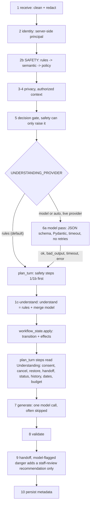

# Conversation orchestration (Sprint 6, as implemented)

How one customer message becomes a reply, and where understanding, state and safety each sit. Related:
[CONVERSATION_STATE.md](CONVERSATION_STATE.md) (stores, card lifecycle) and
[WORKFLOW_STATE_MACHINE.md](WORKFLOW_STATE_MACHINE.md) (states, transitions).

## Why it changed
In Sprint 5.1 the independent verifier re-tested every P0 and P1 conversation fix with its own wording. Many held
for the reported sentence only. The planner asked about 40 narrow detectors, each at its own step, whether a message
was a handoff, a cancel, a status check or a correction. One step's answer could contradict another's.
Audit findings:
- `is_staff_request` was asked at 5 steps, `is_status_request` at 4, `is_lost_or_frustrated_with_chat` at 3.
- `extract_budget` was asked at 2 steps and `extract_issue_restate` at 3.
- Consent was `is_affirmative or is_explicit_send`.
- These paraphrase categories failed:
  - handoff ("put me through to your supervisor");
  - cancel ("scrap that");
  - restore ("I hit Don't send by accident");
  - frustration ("this is going nowhere");
  - a description rewrite ("the description should be: X", saved with the prefix);
  - a tour date written to Move-in;
  - "forget it, <question>" discarding the card;
  - "has anyone fixed this before?" ignored with "Got it".

## The turn

## The understanding layer (`app/understanding.py`)
`understand(msg, draft, pending, recent, model_hint) -> Understanding` returns, in one Pydantic object:
- `primary_intent` / `secondary_intents`;
- `dialogue_act` plus `acts`. The acts are new_request, provide_information, ask_question, correct_information,
  confirm, decline, cancel, check_status, request_human, switch_topic, resume_task, express_frustration,
  report_possible_emergency and small_talk;
- `entities`: issue description, `issues` (two or more problems), location, community, city, `tour_date` vs
  `move_in_date`, budget, contact preference, entry permission (rules only), reference id;
- `corrections` as `[{field, value}]`;
- `requests_human`, `references_existing_request`, `needs_clarification`, `question_topic` (including `history`) and
  `frustration_target` (assistant or situation);
- `explicit_send` (rules only), `confidence`, `source` (`rules`, `model` or `merged`) and `model_status`.

**Rules pass** (always runs, offline). It combines `dialogue.classify_turn`, the `intake` detectors and *frame*
detectors. A frame is a small grammar, not a list of sentences:
- request verb + communication verb + person ("can I get hold of a real human");
- cancel frames with negation guards ("don't cancel it" and "never mind the location, it's the kitchen" are not
  cancels);
- button-press restores;
- status frames that exclude history questions;
- frustration with the chat vs about the situation;
- description-rewrite frames;
- budget frames with income and price-question guards;
- clause-based date roles.

**Model pass** (optional). It runs only when the provider is live and `UNDERSTANDING_PROVIDER` is `model` or
`auto`; the default is `rules` (read from Settings when the field exists, otherwise the environment):
- one `gateway.complete` call with `SCHEMA` (`mckinley_understanding`), temperature 0, no retries, and a timeout of
  `UNDERSTANDING_TIMEOUT_SECONDS` (default 5);
- it sees only the message, the last three user messages and the open card's kind and missing field, never account
  data;
- invalid JSON, a schema violation, a timeout, a rate limit or an error returns `(None, status)`, and the turn uses
  the rules result, labelled in the trace.

**Merge policy** (code, `merge`):
- The model's acts are used only when the rules found nothing specific (rules confidence below 0.8).
- `confirm` from the model is dropped, and model `entry_permission` and `reference_id` are discarded.
- Model entities and corrections must be grounded: every content word appears in the message.
- `report_possible_emergency` is OR-ed and never cleared. It is passed to the safety layer as the `pass_to_safety`
  effect. If the model alone flagged it, step 9 adds a high-priority staff-review recommendation: a raise only, with
  no invented alert text.
- Confidence never authorises anything.

## What plan_turn reads from it (step 1c-understand onward)
| Before (keyword check at each step) | Now |
| --- | --- |
| `is_staff_request(msg)` (5 places) | `wants_person = u.requests_human` |
| `is_status_request(msg)` (after 1c) | `status_q = u.has(CHECK_STATUS)` (history questions excluded) |
| `is_lost_or_frustrated_with_chat(msg)` (1c-lost) | `chat_frustrated` (frustration with the assistant) |
| `classify_turn` acts | `with_acts(u)`: the same acts, plus paraphrased CANCEL and RESTORE; "don't cancel" removes CANCEL |
| `is_affirmative or is_explicit_send` (consent) | the state machine's `confirm_explicit` / `confirm_bare` |
| `extract_budget(msg)` | `u.entities.budget` |
| `extract_issue_restate(msg)` (corrections) | `und.issue_rewrite(msg)` (also "the description should be: X") |
| `extract_move_in` / `extract_tour_date` (tour card) | `und.dates(...)`: one field per date, by clause and card state |

The safety, identity, injection and contact-privacy steps before 1c still run first, and nothing here can lower them.

## Measured
- Journey suite (MOCK, 35): 27 PASS / 8 WARN / 0 FAIL before, 28 / 7 / 0 after. Duplicates stayed at 0, and
  honesty and safety flags stayed at 0.
- New tests: 258 in `tests/test_sprint6_conversation*.py` (208 paraphrase-family and API replays, 50 model-path and state-machine tests).
- Live model check (5 calls, `openrouter:nvidia/nemotron-3.5-super-vl:free`):
  - 4 of 5 returned schema-valid JSON; 1 was rate-limited (429) and fell back to the rules.
  - The labels were noisy. It flagged a handoff on "forget it, what are the pool hours?" and possible emergencies on
    a routine leak correction and a warm fridge.
  - That is why a confident rules reading is never overridden, and why `auto` should stay off with this model.

## Known limits
- Rules frames are still English-first. The Spanish coverage is the older detectors.
- Steps 5 to 13 of `plan_turn` still route on their own; the table drives consent, cancel, restore and switch-topic.
- Model quality has not been evaluated beyond the 5-call sanity check. Use `rules` until a held-out paraphrase set
  written by someone else shows a benefit.
