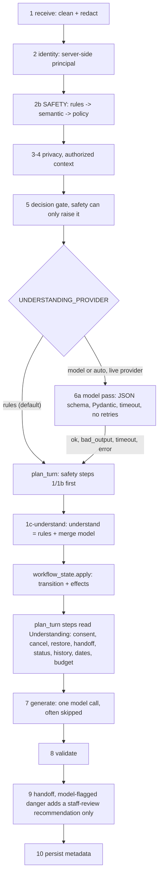
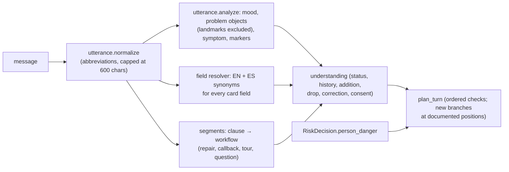

# Conversation orchestration (Sprint 6, as implemented)

How one customer message becomes a reply, and where understanding, state and safety each sit. Related:
[CONVERSATION_STATE.md](CONVERSATION_STATE.md) (stores, card lifecycle) and
[WORKFLOW_STATE_MACHINE.md](WORKFLOW_STATE_MACHINE.md) (states, transitions).

## Why it changed
In Sprint 5.1 the independent verifier re-tested every P0 and P1 conversation fix with its own wording. Many held
for the reported sentence only. The planner asked about 40 narrow detectors, each at its own step, whether a message
was a handoff, a cancel, a status check or a correction. One step's answer could contradict another's.
Audit findings:
- `is_staff_request` was asked at 5 steps, `is_status_request` at 4, `is_lost_or_frustrated_with_chat` at 3.
- `extract_budget` was asked at 2 steps and `extract_issue_restate` at 3.
- Consent was `is_affirmative or is_explicit_send`.
- These paraphrase categories failed:
  - handoff ("put me through to your supervisor");
  - cancel ("scrap that");
  - restore ("I hit Don't send by accident");
  - frustration ("this is going nowhere");
  - a description rewrite ("the description should be: X", saved with the prefix);
  - a tour date written to Move-in;
  - "forget it, <question>" discarding the card;
  - "has anyone fixed this before?" ignored with "Got it".

## The turn

## The understanding layer (`app/understanding.py`)
`understand(msg, draft, pending, recent, model_hint) -> Understanding` returns, in one Pydantic object:
- `primary_intent` / `secondary_intents`;
- `dialogue_act` plus `acts`. The acts are new_request, provide_information, ask_question, correct_information,
  confirm, decline, cancel, check_status, request_human, switch_topic, resume_task, express_frustration,
  report_possible_emergency and small_talk;
- `entities`: issue description, `issues` (two or more problems), location, community, city, `tour_date` vs
  `move_in_date`, budget, contact preference, entry permission (rules only), reference id;
- `corrections` as `[{field, value}]`;
- `requests_human`, `references_existing_request`, `needs_clarification`, `question_topic` (including `history`) and
  `frustration_target` (assistant or situation);
- `explicit_send` (rules only), `confidence`, `source` (`rules`, `model` or `merged`) and `model_status`.

**Rules pass** (always runs, offline). It combines `dialogue.classify_turn`, the `intake` detectors and *frame*
detectors. A frame is a small grammar, not a list of sentences:
- request verb + communication verb + person ("can I get hold of a real human");
- cancel frames with negation guards ("don't cancel it" and "never mind the location, it's the kitchen" are not
  cancels);
- button-press restores;
- status frames that exclude history questions;
- frustration with the chat vs about the situation;
- description-rewrite frames;
- budget frames with income and price-question guards;
- clause-based date roles.

**Model pass** (optional). It runs only when the provider is live and `UNDERSTANDING_PROVIDER` is `model` or
`auto`; the default is `rules` (read from Settings when the field exists, otherwise the environment):
- one `gateway.complete` call with `SCHEMA` (`mckinley_understanding`), temperature 0, no retries, and a timeout of
  `UNDERSTANDING_TIMEOUT_SECONDS` (default 5);
- it sees only the message, the last three user messages and the open card's kind and missing field, never account
  data;
- invalid JSON, a schema violation, a timeout, a rate limit or an error returns `(None, status)`, and the turn uses
  the rules result, labelled in the trace.

**Merge policy** (code, `merge`):
- The model's acts are used only when the rules found nothing specific (rules confidence below 0.8).
- `confirm` from the model is dropped, and model `entry_permission` and `reference_id` are discarded.
- Model entities and corrections must be grounded: every content word appears in the message.
- `report_possible_emergency` is OR-ed and never cleared. It is passed to the safety layer as the `pass_to_safety`
  effect. If the model alone flagged it, step 9 adds a high-priority staff-review recommendation: a raise only, with
  no invented alert text.
- Confidence never authorises anything.

## What plan_turn reads from it (step 1c-understand onward)
| Before (keyword check at each step) | Now |
| --- | --- |
| `is_staff_request(msg)` (5 places) | `wants_person = u.requests_human` |
| `is_status_request(msg)` (after 1c) | `status_q = u.has(CHECK_STATUS)` (history questions excluded) |
| `is_lost_or_frustrated_with_chat(msg)` (1c-lost) | `chat_frustrated` (frustration with the assistant) |
| `classify_turn` acts | `with_acts(u)`: the same acts, plus paraphrased CANCEL and RESTORE; "don't cancel" removes CANCEL |
| `is_affirmative or is_explicit_send` (consent) | the state machine's `confirm_explicit` / `confirm_bare` |
| `extract_budget(msg)` | `u.entities.budget` |
| `extract_issue_restate(msg)` (corrections) | `und.issue_rewrite(msg)` (also "the description should be: X") |
| `extract_move_in` / `extract_tour_date` (tour card) | `und.dates(...)`: one field per date, by clause and card state |

The safety, identity, injection and contact-privacy steps before 1c still run first, and nothing here can lower them.

## Fix round (after the independent simulators)
Simulators with unseen wording found that corrections were appended to "What's wrong", two issues joined by "; also",
"and separately", "1) … 2)" or "y aparte" stayed on one card, and a second request to reach a person, accept an offer,
or name a month-less date ("push it to the 20th") was missed. The fixes are typed frames in `app/understanding.py`,
applied in one place (`plan_turn` step 1c-edit):
- **Field-targeted edits** (`field_edits(msg, card, kind)` → `Understanding.edits`). Each edit names ONE field with a
  value of that field's type: contact channel (call/text/email/portal, "X is better than Y" and "X not Y" take X, and a
  preference frame is required, so "nobody answered my 2 emails" changes nothing), entry permission ("knock first",
  "they can NOT just come in", "mejor que me llamen antes de entrar"), visit time ("after 6pm not 5", "mornings only"),
  location ("inside my apt not common area", "where: X") and the description ("let me rephrase:", "correction:",
  "change it to: X", "it's under the sink not the dishwasher itself" keeps the symptom). A question ("when will they
  call me?") is never an edit. Edits REPLACE the field; after Send they become a change note citing the reference.
- **Splits**: `intake.split_issues` knows more joins and symptoms; `asks_split` handles a later request; `partial_cancel`
  and `holds` keep "never mind the X" and "don't send yet" from discarding the card.
- **Handoff by frame**: (a person / someone from the office / whoever handles X) + (call me, reach out, take over,
  connect me with, a callback from), for prospects too, with the entry guard ("have someone call me first before they
  come in" is an entry answer). An explicit request for a person beats the "chat isn't helping" recovery.
- **Frustration about the repair** ("this is the FOURTH time my sink is leaking, i'm so done") starts the repair (repeat
  flag) instead of a "the chat wasn't helping" note, unless the chat itself is named.
- **Saved-status and history** questions are answered from this conversation's records, even with a draft open.
- **Dates and budgets**: `date_target` puts "the 20th" in the field the card holds, or asks "the tour or the move-in?"
  when it holds both; `budget_range` keeps "1200 to 1400". A community named earlier in the chat beats the profile's.
- **Offers**: the reply's offer (`tour`, `leasing_note`) is kept in planner memory (a kind, never text); "ok sure" or
  "yeah send them my questions" opens that card. Saving still needs Send or an explicit "send it".
- **Notes**: a rebuilt note keeps "Details so far", the questions, budget and a stated contact preference; a note with
  none of the person's own details is confirmed without "with the details".
- **Staff complaints** ("the tech was rude", "missed my Tuesday visit, I want an explanation") are a note for a manager.

## Measured
- Journey suite (MOCK, 35): 27 PASS / 8 WARN / 0 FAIL before, 28 / 7 / 0 after. Fix round: 28 / 7 / 0 before,
  29 / 6 / 0 after (the one change is a safety journey; the safety engineer's concurrent work may account for it).
  Fix-round tests: in `tests/test_conversation_understanding.py`.
- Duplicates stayed at 0, and
  honesty and safety flags stayed at 0.
- Tests: paraphrase families, API replays, model-path and state-machine tests in `tests/test_conversation_understanding.py`.
- Live model check (5 calls, `openrouter:nvidia/nemotron-3.5-super-vl:free`):
  - 4 of 5 returned schema-valid JSON; 1 was rate-limited (429) and fell back to the rules.
  - The labels were noisy. It flagged a handoff on "forget it, what are the pool hours?" and possible emergencies on
    a routine leak correction and a warm fridge.
  - That is why a confident rules reading is never overridden, and why `auto` should stay off with this model.

## Known limits
- Rules frames are still English-first. The Spanish coverage is the older detectors.
- Steps 5 to 13 of `plan_turn` still route on their own; the table drives consent, cancel, restore and switch-topic.
- Model quality has not been evaluated beyond the 5-call sanity check. Use `rules` until a held-out paraphrase set
  written by someone else shows a benefit.

## Sprint 7: structural analysis instead of per-step keyword lists
The Sprint 7 audit found that the Sprint 6 layer mostly wrapped keyword regexes in a schema. Independent detectors
were checked first-match-wins, several object lexicons covered the same things, there was no shared field resolver,
questions and statements were told apart late, and each message had one intent. What changed
(../evaluation/SPRINT7_GENERALIZATION.md (removed; in Git history at `59c155c`)):

- `app/utterance.py`: one analysis per message, used by the status, history, addition, new-problem and drop
  decisions instead of separate lists. "Next to the fridge" is a landmark, not a new problem.
- A single EN + ES field-reference resolver serves corrections before and after Send.
- Two workflows in one message are both kept: the repair card comes first, and the callback note is named and
  queued.
- The cancel target is the object of the cancel verb, and "keep / just / only X" names what stays.
- After Send, a detail or correction becomes a change note citing the reference. A typed reference is cited only if
  it is the caller's own record, and change notes target the original request.
- A question never edits a card (`utterance.ends_as_question`).
- No repair card is opened while a person may be in danger in this turn (`RiskDecision.person_danger`).
- Invariant and metamorphic tests: `tests/test_authorization.py`, `test_conversation_understanding.py`.
