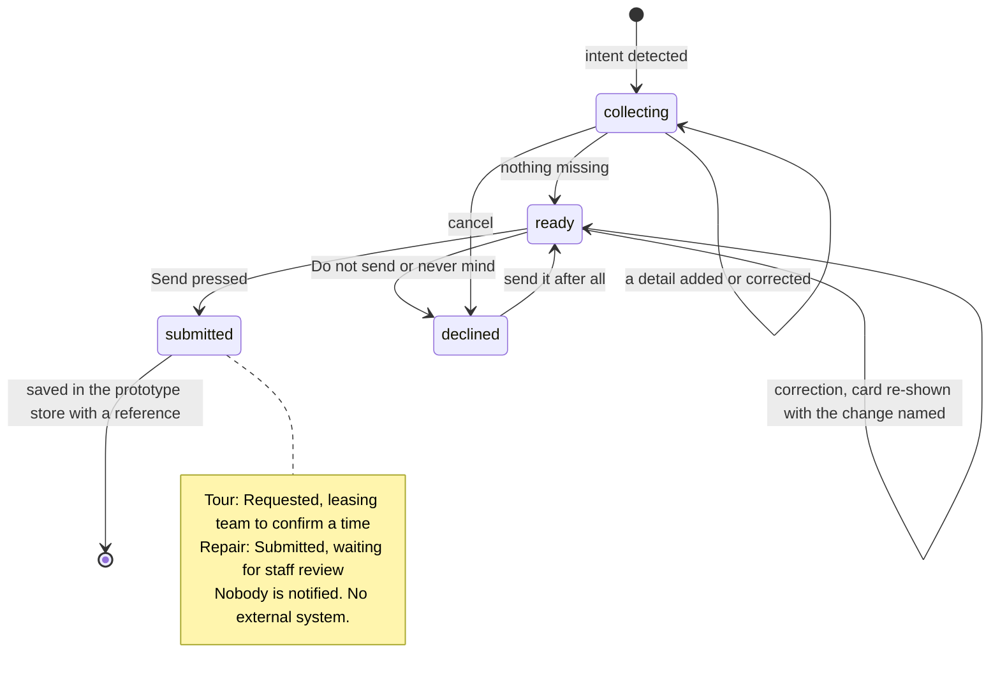

# Conversation state and workflow engine (as implemented, Sprint 5)

This describes what the code does today. Pipeline order and safety: [overview.md](overview.md) and
[../diagrams/](../diagrams/). Code: `backend/app/chat_engine.py` (`run_turn`), `backend/app/actions.py`
(`plan_turn`, cards), `backend/app/intake.py` (detectors and extractors), `backend/app/templates.py` (wording).

## Where state lives (per `session_id` + persona)

| Store table | What it holds | Never holds |
| --- | --- | --- |
| `chat_turns` | The conversation per session, mode and persona; the model sees only the last few turns | Raw contact details (email and phone are redacted on receive) |
| `action_drafts` | **One open card** per session and persona: kind, fields with their source (you told us / on your account / added by the assistant), what is missing, priority, repeat or frustration flags, `declined`, `stale` | Anything already sent |
| `prototype_records` | Saved cards (Send pressed): reference (`DEMO-WO-…`, `DEMO-TOUR-…`, `DEMO-TASK-…`), status label, team, priority, fields | A real work order or booking. Nothing leaves this store and nobody is notified |
| `gate_decisions` | Per-turn metadata: intent, workflow, safety rule, reply source, action stage, and **`planner_memory`** (counts and flags only) | Message text |

`planner_memory` carries the turn-to-turn facts the planner needs:
- the unproductive-turn streak, and the per-question ask counts;
- whether a tour was already offered, and the last saved reference.

It rides on the previous turn's gate-log row (`store.last_gate`) and is rewritten each turn.

Identity comes only from the app's trusted context: the demo persona (`persona_id`). It never comes from the
message or the model. **This is not authentication.** Any caller can send any `persona_id` (release-blocking; see
[../DEPLOYMENT_READINESS.md](../DEPLOYMENT_READINESS.md)).

## The turn (`run_turn`)
1. **Receive.** Clean the message and redact email and phone patterns.
2. **Identity.** Load the persona's allowlisted context. The account-holder rule (`apply_account_holder_rule`)
   narrows it when someone says they are using another person's account.
3. **Safety.** Deterministic rules, then the semantic classifier (when a provider key exists; otherwise
   `degraded`), then policy R1–R9e. This runs before routing, and nothing later can lower it.
4. **Gate.** Intent and urgency from rules, or from the model gate when configured.
5. **Workflow selection and triage.** Maintenance triage, lead profile, renewal assessment.
6. **`plan_turn`**, an ordered list of checks where the **order is the specification**. It returns a template
   and/or a card and/or records, plus `skip_model`.
7. **Generate.** One model call only when the plan needs free text; otherwise the approved template is used. The
   reply source is recorded (`model`, `template`, `template_after_validation`, `template_after_model_error`).
8. **Validate.** Output checks: no invented commitments, prices or dispatch.
9. **Handoff decision**, then **persist** (history, gate log, `planner_memory`).

## Card lifecycle (all kinds)

- **Only Send saves.** A card is never submitted by the model or by a reply, and green appears only after the
  backend returns a saved record.
- **Corrections:**
  - A correction updates the open card and says what changed.
  - A second community for a tour reuses the days and time already given.
  - A new detail for an already-sent request becomes a change note with that reference, not a duplicate.
- **Questions asked at most twice:** if a detail is still unanswered after two asks, the card leaves it for staff
  to ask about.

## Tour request states (B1)
| State | Shown to the prospect | Backend |
| --- | --- | --- |
| Intent detected | "I'd be glad to set up a tour request…" | Draft created |
| Collecting | One question at a time (community, days, time); move-in is stored separately from tour timing | `stage=collecting` |
| Ready | Card plus "Check, then send"; "this isn't a booking yet" | `stage=ready` |
| Submitted / pending staff review | "Requested; leasing team to confirm a time", plus a reference | `prototype_records`, status `requested` |
| Confirmed by an external system | **Not implemented** (no CRM or calendar integration); never claimed | — |
| Cancelled | "Okay, I haven't sent anything." | Draft marked declined |

**Contact route:**
- The card shows "On your profile" if the profile has a contact; otherwise "Not collected in this prototype"
  (true for all current fictional prospects).
- Contact details typed in chat are redacted and **not stored**; the reply says so.

**Floor plans and prices:** no approved content exists, so the answer is one honest line plus a next step. The
tour pitch is offered at most once per session.

## Resident workflows
- **Maintenance:**
  - Issue, location and entry permission are collected.
  - A bare "ok" to the entry question gets a confirmation.
  - "Text me first" replaces the profile's contact preference.
  - Repeat issues (English and Spanish phrases) raise the priority.
  - Lock or entry-door repairs offer Front door first and are high priority.
  - Two issues in one message: one card at a time (a known P1).
- **Status:** shows the person's open requests. "The one for the sink leak" answers about that request.
- **Handoff:**
  - A request for a person (any state, including right after declining) or a manager (routes to management)
    produces a note card.
  - A lost or frustrated user gets one apology and the single next step, then a note carrying the details
    already given.
  - Every note says that nobody is notified automatically.
- **Renewal / lease break:** renewal concerns go to the renewal note. Early move-out and lease break have their own
  wording and go to leasing, never "renewal".
- **Language:** Spanish is detected per message. A conversation that started in Spanish stays in Spanish (the
  Spanish strings are drafts).

## What the model may and may not do
- **May:**
  - write the reply text when the plan asks for it;
  - classify intent (model gate);
  - add caution (semantic classifier).
- **May not:**
  - change identity;
  - create, submit or cancel a card;
  - lower a deterministic safety alert;
  - claim staff were notified;
  - quote prices or availability.

Provider calls go through `app/llm/contracts.py` (`generate_response`, `decide_gate`, `classify_risk`) and the
provider-independent gateway ([../deployment/gemini.md](../deployment/gemini.md), "Provider contract").

## Known gaps
- No authentication: the persona comes from the client.
- One open card per conversation.
- No real external confirmation of anything.
- The safety recall gaps are release-blocking ([../evaluation/SPRINT5_LIVE_CONVERSATION.md](../evaluation/SPRINT5_LIVE_CONVERSATION.md)).
