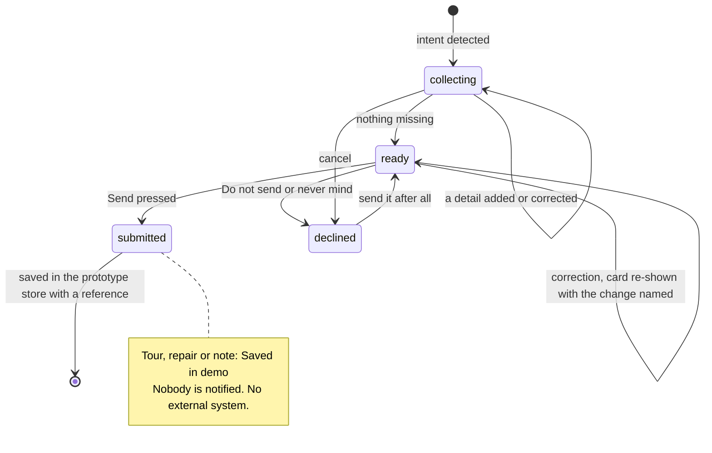

# Conversation state and workflow engine (as implemented, Sprint 6)

This describes what the code does today. Pipeline order and safety: [overview.md](overview.md) and
[../diagrams/](../diagrams/). Code: `backend/app/chat_engine.py` (`run_turn`), `backend/app/actions.py`
(`plan_turn`, cards), `backend/app/intake.py` (detectors and extractors), `backend/app/templates.py` (wording).

## Where state lives (per `session_id` + persona)

| Store table | What it holds | Never holds |
| --- | --- | --- |
| `chat_turns` | The conversation per session, mode and persona; the model sees only the last few turns | Raw contact details (email and phone are redacted on receive) |
| `action_drafts` | **One open card** per session and persona: kind, fields with their source (you told us / on your account / added by the assistant), what is missing, priority, repeat or frustration flags, `declined`, `stale` | Anything already sent |
| `prototype_records` | Saved cards (Send pressed): reference (`DEMO-WO-…`, `DEMO-TOUR-…`, `DEMO-TASK-…`), status label, team, priority, fields | A real work order or booking. Nothing leaves this store and nobody is notified |
| `gate_decisions` | Per-turn metadata: intent, workflow, safety rule, reply source, action stage, and **`planner_memory`** (counts and flags only) | Message text |

`planner_memory` carries the turn-to-turn facts the planner needs:
- the unproductive-turn streak, and the per-question ask counts;
- whether a tour was already offered, and the last saved reference;
- a language pin (`lang_pin`) set only by an explicit request for English or Spanish;
- normalised tour preferences a prospect gave before any card existed (`lead`: city, beds, pets, budget). These are
  extracted values, never message text.

It rides on the previous turn's gate-log row (`store.last_gate`) and is rewritten each turn.

Identity comes only from the app's trusted context, never from the message or the model. Since Sprint 6 the
server resolves a principal (`app/auth.py`): a demo persona is usable only locally or in development, a session is
bound to its first persona (403 on a mismatch), and every read goes through the deny-by-default `ScopedStore`.
Hosted mode turns demo personas off (public information only). **A demo persona is still not authentication**
(release-blocking until real sign-in exists; see [../security/AUTHORIZATION_BOUNDARIES.md](../security/AUTHORIZATION_BOUNDARIES.md)).

## The turn (`run_turn`)
1. **Receive.** Clean the message and redact email and phone patterns.
2. **Identity.** Load the persona's allowlisted context. The account-holder rule (`apply_account_holder_rule`)
   narrows it when someone says they are using another person's account.
3. **Safety.** Deterministic rules, then the semantic classifier (when a provider key exists; otherwise
   `degraded`), then policy R1–R9e. This runs before routing, and nothing later can lower it.
4. **Gate.** Intent and urgency from rules, or from the model gate when configured.
5. **Workflow selection and triage.** Maintenance triage, lead profile, renewal assessment.
6. **`plan_turn`**, an ordered list of checks where the **order is the specification**. It returns a template
   and/or a card and/or records, plus `skip_model`.
   - Step **1c-acts** (Sprint 5.1) classifies the message with `app/dialogue.classify_turn` into typed dialogue acts
     (ANSWER, CORRECTION, NEW_DETAIL, QUESTION, CANCEL, RESTORE, META, NEW_ISSUE, SMALL_TALK) before anything can
     change the open card. It runs after the safety, identity, injection and contact-privacy steps.
   - Only ANSWER, CORRECTION and NEW_DETAIL change fields. A QUESTION (who sees it, what Send does, cost, priority,
     timing, a phone number, a gate code, renewal, a name, the budget) gets an honest answer and the card stays.
   - Step **1c-understand** (Sprint 6) understands the message once, in a typed object (`app/understanding.py`:
     rules plus an optional, validated model pass), and runs the card's state machine (`app/workflow_state.py`).
     Later steps read that object instead of their own keyword checks. See
     [CONVERSATION_ORCHESTRATION.md](CONVERSATION_ORCHESTRATION.md) and
     [WORKFLOW_STATE_MACHINE.md](WORKFLOW_STATE_MACHINE.md).
   - "Has anyone fixed this before?" is answered from the signed-in resident's own history: reference, subject,
     status and date only. The card stays.
7. **Generate.** One model call only when the plan needs free text; otherwise the approved template is used. The
   reply source is recorded (`model`, `template`, `template_after_validation`, `template_after_model_error`).
8. **Validate.** Output checks: no invented commitments, prices or dispatch.
9. **Handoff decision**, then **persist** (history, gate log, `planner_memory`).

## Card lifecycle (all kinds)

- **Only Send saves.** A record is written only by the Send button or an explicit typed instruction ("send it",
  "yes send it", "submit it", "envíelo"). Saving is idempotent: a card identical to a request already saved in this
  chat shows that request ("…didn't save it twice") and writes nothing. A bare "yes", "ok", "sure" or "sí" on a ready card gets "Tap Send when it looks
  right" and the card stays. A card is never submitted by the model, and green appears only after the backend
  returns a saved record.
- **Cancel and restore:** "never mind, don't send it" cancels even inside a longer sentence, and so do
  paraphrases ("scrap that, I don't need it anymore", "call it off"). "Don't cancel it" does not. A cancel word
  followed by a new question ("forget it, what are the pool hours?") answers the question and keeps the card,
  unsent, saying how to cancel. A bare "no" to the
  entry question means "contact me first", never cancel. "Undo", "I pressed the wrong button", "I hit Don't send by
  accident", "send it after all" bring back the same card with its fields; an incomplete restored card asks its missing question.
- **Parking (still one open card):** a second need while a card is open (a manager note, a renewal note asked twice)
  parks the first card inside the note. It comes back after the note is sent or skipped, and the reply says so.
- **Corrections:**
  - A correction updates the open card and says what changed ("change what's wrong to: X", "the description
    should be: X" replace with X, never with the prefix). "Actually, it is the bedroom AC" says "Updated: Where →
    Bedroom" and the intake continues.
  - A date on an open tour card goes to one field only: a clause about moving goes to Move-in; "could we do
    December 14th instead?" goes to the tour days.
  - A problem that matches a request already open (sent in this chat, or open on the record) becomes a follow-up
    note citing its reference, never a duplicate. A sent request can't be edited here.
  - A second community for a tour reuses the days and time already given.
  - A new detail for an already-sent request becomes a change note with that reference, not a duplicate.
- **Questions asked at most twice:** if a detail is still unanswered after two asks, the card leaves it for staff
  to ask about.

## Tour request states (B1)
| State | Shown to the prospect | Backend |
| --- | --- | --- |
| Intent detected | "I'd be glad to set up a tour request…" | Draft created |
| Collecting | One question at a time (community, days, time); move-in is stored separately from tour timing | `stage=collecting` |
| Ready | Card plus "Check, then send"; "this isn't a booking yet" | `stage=ready` |
| Saved in demo | "Saved in demo" (one label for every kind since Sprint 9, from `models.STATUS_LABEL` on every read), plus a reference | `prototype_records`, status `requested` |
| Confirmed by an external system | **Not implemented** (no CRM or calendar integration); never claimed | — |
| Cancelled | "Okay, I haven't sent anything." | Draft marked declined |

**Contact route:**
- The card shows "On your profile" if the profile has a contact; otherwise "Not collected in this prototype"
  (true for all current fictional prospects).
- Contact details typed in chat are redacted and **not stored**; the reply says so.

**Floor plans and prices:** no approved content exists, so the answer is one honest line plus a next step. The
tour pitch is offered at most once per session.

## Resident workflows
- **Maintenance:**
  - Issue, location and entry permission are collected.
  - A bare "ok" to the entry question gets a confirmation.
  - "Text me first" replaces the profile's contact preference.
  - Repeat issues raise the priority. A repeat from the record needs a history item about the same thing; a repeat
    the person states needs a named problem ("the thing again" is not one). The response model is told the
    planner's repeat decision and may not claim history otherwise.
  - Entry and contact wording ("text me, don't call", "contact me first") goes to its fields, never into "What's
    wrong". Pets and "keep the door shut" go to "Notes for the visit".
  - Common-area repairs (front gate, parking lot, lobby) need no room and no entry permission.
  - Lock or entry-door repairs offer Front door first and are high priority.
  - Two issues in one message: one card at a time, never merged. The card's note names the waiting problems
    ("Waiting as separate requests, after this one: …"). After Send, "yes" starts the next one, with the room taken
    from its description.
- **Status:** shows the person's open requests. "The one for the sink leak" answers about that request.
- **Handoff:**
  - A request for a person (any state, including right after declining) or a manager (routes to management)
    produces a note card.
  - A lost or frustrated user gets one apology and the single next step, then a note carrying the details
    already given.
  - Every note says that nobody is notified automatically.
- **Renewal / lease break:** renewal concerns go to the renewal note. Early move-out and lease break have their own
  wording and go to leasing, never "renewal".
- **Language:** an explicit request for English or Spanish switches and sticks. Otherwise a clearly English or
  Spanish message is answered in that language, and an unclear one ("no", "sí", "leak") keeps the conversation's
  language. The Spanish strings are drafts.

## What the model may and may not do
- **May:**
  - write the reply text when the plan asks for it;
  - classify intent (model gate);
  - add caution (semantic classifier).
- **May not:**
  - change identity;
  - create, submit or cancel a card;
  - lower a deterministic safety alert;
  - claim staff were notified;
  - quote prices or availability.

Provider calls go through `app/llm/contracts.py` (`generate_response`, `decide_gate`, `classify_risk`) and the
provider-independent gateway ([../deployment/gemini.md](../deployment/gemini.md), "Provider contract").

## Known gaps
- No real authentication: a demo persona is chosen in the browser (server-side principal and session binding limit
  what it can reach; hosted mode turns it off).
- One open card per conversation (a second card is parked inside a note, or queued and named on the card; not
  shown side by side).
- No real external confirmation of anything.
- The safety recall gaps are release-blocking ([../evaluation/SPRINT6_RESULTS.md](../evaluation/SPRINT6_RESULTS.md) §4).
