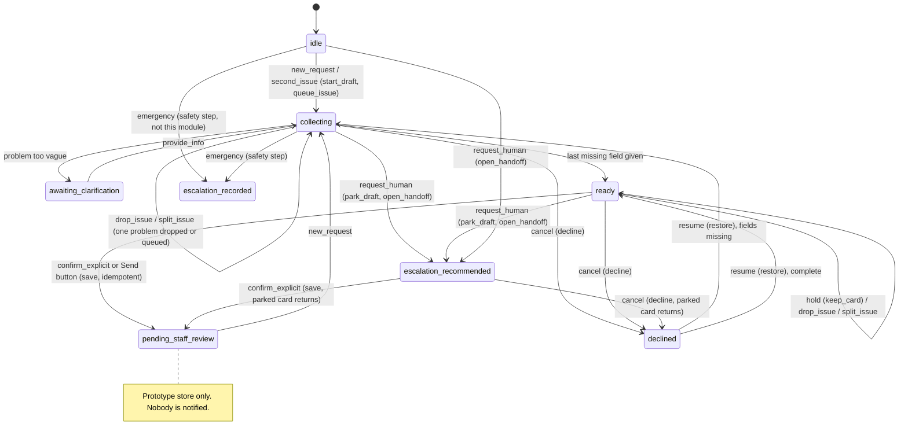

# Workflow state machine (Sprint 6, as implemented)

Code: `backend/app/workflow_state.py` (states, events, `TRANSITIONS`, `derive`, `apply`, `duplicate_of`), wired into
`backend/app/actions.py` (`plan_turn` step 1c-understand and step 2; `confirm`). Tests:
`backend/tests/test_conversation_understanding.py` (state machine) and `test_conversation_understanding.py` (API replays).

## Principles
- **The state is derived, never stored twice.** `derive(draft, records)` reads the open draft (its kind, missing
  fields, `declined`, `vague_issue`, `parked`, `queued`) and the records saved in the session. It can't drift from
  the card on screen.
- **`apply(snapshot, understanding)` is pure.** It looks the event up in the explicit `TRANSITIONS` table and returns
  the next state plus *effects*: proposals such as `update_field`, `park_draft`, `open_handoff`, `ask_next`,
  `prompt_send`, `save`. `plan_turn` executes them. Nothing in `workflow_state.py` writes to the store.
- **Illegal transitions are rejected** with a reason and no effects, for example `save` while collecting, restore
  with nothing declined, or cancel with nothing open.
- **Only an explicit confirmation proposes `save`.** That means the Send button (`/api/actions/confirm`) or a typed
  "send it", "submit it" or "envíelo" (`Understanding.explicit_send`, rules only). A bare "yes", "ok" or "sí"
  proposes `prompt_send` ("Tap Send…"). A model can never produce a save, because model CONFIRM acts are dropped in
  the merge.
- **Saving is idempotent.** `confirm()` takes the draft atomically first, so concurrent Sends still write at most
  one record. It then checks `duplicate_of`, which compares the kind and the person's field values with records
  already saved in this session for this person. If they match, it shows that record (`error_code="ALREADY_SAVED"`,
  "…already has these details, so I didn't save it twice") and writes nothing.
- **Safety is not decided here.** A possible emergency adds `pass_to_safety` on top of the message's own event. The
  safety steps run before all of this: `chat_engine` 2b, and `plan_turn` 1 and 1b, which belong to the safety
  engineer. `EMERGENCY` is the event those steps cause (an urgent note recorded); `event_for` never returns it.

## States
| State | Derived from | Shown to the person |
| --- | --- | --- |
| `idle` | no open draft, nothing saved | the menu or the answer |
| `collecting` | open draft with a missing required field | the card plus one question |
| `awaiting_clarification` | repair card whose problem is vague ("it's broken") | "What is it that isn't working?" |
| `ready` | nothing missing | card plus "Tap Send" |
| `pending_staff_review` | a non-urgent record saved, no open draft | the reference and "nobody is notified" |
| `declined` | draft marked `declined` (restorable once) | "Okay, I haven't sent it" |
| `escalation_recommended` | an open note for the office (a parked card may ride inside it) | the note card |
| `escalation_recorded` | an urgent note saved by the safety step | the fixed safety text |

A **parked** card is not a separate state. It is the repair or tour card stored inside an open note
(`draft["parked"]`). It comes back when the note is sent (`confirm`) or skipped (`decline` plus `restore`).
**Queued** problems (`draft["queued"]`) are the other problems from a two-issue message. The card's note names them,
and after Send they become the next card.

## Transitions

Events come from `event_for(understanding)`, checked most consequential first: `confirm_explicit` (button or typed
send) → `request_human` → `resume` → `switch_topic` → `hold` → `drop_issue` → `split_issue` → `cancel` → `correct` → `check_status` → `confirm_bare` →
`frustration` (with the assistant) → `provide_info` → `ask` → `second_issue` → `small_talk` → `new_request`.
So "yes, but it's the kitchen, not the bathroom" is a correction, never consent. "Forget it, what are the pool
hours?" is `switch_topic`: the question is answered and the card stays, unsent, with a line saying how to cancel.

Fix round events (rules only, so a model can't cause them):
- `hold` ("don't send it yet", "not yet", "hold on"): the card stays on screen, unsent. It is never a cancel.
- `drop_issue` ("never mind the smoke detector, only the faucet"): that one problem leaves the card (or its queue). If it
  is the only problem on the card, the message is an ordinary cancel.
- `split_issue` ("those are 2 different things", "make the oven light its own request"): one request per problem; the
  others are queued and become the next card after Send. A card that is already split says so and changes nothing.
- A cancel word that leads a correction ("nvm switch it to Heron Lake") is `correct`, not `cancel`.

## Where plan_turn uses it (documented position)
- **Top (declined card):** `apply(derive(declined), u0)` → `restore`. This is how paraphrased restores ("I hit
  Don't send by accident") bring back the same card.
- **Step 1c-understand:** `tr = apply(derive(live, mine), u)`, plus the switch-topic branch.
- **Step 1c-edit (fix round, right after the switch-topic branch):** `hold`, `drop_issue` and `split_issue`, then
  `u.edits` (field-targeted corrections) are applied to the open card, and the reply names each change ("Updated:
  Contact preference → Prefers call"). With no open card (or only an untouched queued card) and a record just sent,
  the same edit becomes a change note citing that record's reference. Then: more detail for an open note, a pet on
  an open tour card, and accepting the assistant's last offer (`memory["offer"]`: `tour` or `leasing_note`).
- **Step 2 (consent):** `tr2.event in (confirm_explicit, confirm_bare)`. `prompt_send` gives "Tap Send"; `save`
  calls `confirm()`. This replaced `is_affirmative(msg) or is_explicit_send(msg)`.
- **`confirm()`:** `duplicate_of` after the atomic `take_draft`.
- The `transition` summary (from, event, to, effects: names only) goes on `TurnPlan.transition` and into the
  pipeline trace (`6a_understanding`).

## Not yet driven by the table
`plan_turn`'s later steps (5 to 13) still decide most routing themselves, though they now read the understanding
(`wants_person`, `status_q`, `chat_frustrated`, `act`). The table is authoritative for consent, cancel, restore,
switch-topic and the duplicate check. Moving the remaining branches over is future work, one tested branch at a time.

## Sprint 7 additions
- **Duplicate guard.** `near_duplicate_of(kind, draft, records)` stops a second save of the same repair, even when it
  is reworded ("mirror is cracked" / "mirror has a crack"). Confirm returns `POSSIBLE_DUPLICATE`; "it's a different
  problem / save it as a new request" sets `draft["dup_ok"]` and allows it. The exact-fingerprint `duplicate_of`
  check is unchanged.
- **Queued items across workflows.** A note for the office (a callback) can be queued behind a repair card from the
  same message (`draft["queued_note"]`). A prospect's tour can be queued behind an open note. The reply names
  what is waiting.
- **Targeted cancel (step 1c-target).** A cancel naming one of two items (the repair or the queued callback) drops
  only that item. A mistaken cancel can be undone from the note that opened in its place.
- **After Send.** Additions and corrections (repair or tour) open a `staff_handoff` change note citing the original
  reference. This is never a second record of the same kind.
- **Consent.** One vocabulary (`intake._SEND_COMMAND`) for every card kind: the whole message must be a send command.
  A typed send on a declined card restores and saves it; a bare yes or ok never saves.
- **Property-based invariants** (`tests/test_authorization.py`, `hypothesis`, derandomized), checked after every
  step of generated act sequences:
  - consent;
  - no duplicate side effects;
  - unrelated fields preserved;
  - questions never mutate;
  - cancelling one of two keeps the other;
  - no booking or dispatch claims;
  - no overwrite of an open workflow;
  - no cross-persona access.
