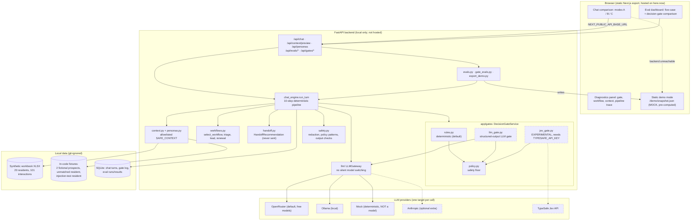

# Architecture (as implemented)

Last verified against code on 2026-11-05 (branch `feat/agentic-workflow-gates`). Solid boxes are working code.
Dashed boxes are optional or experimental and only active when configured. Nothing here writes to an external system.

| Component | File(s) | Status |
|---|---|---|
| Rules gate + safety floor | `backend/app/gates/rules.py`, `policy.py` | WORKING (default) |
| Structured LLM gate | `backend/app/gates/llm_gate.py` | WORKING via mock; untested against a live model in this repo (no key) |
| Jev gate | `backend/app/gates/jev_gate.py` | EXPERIMENTAL: built from public docs and tested with mocked HTTP only |
| Workflows / handoff | `backend/app/workflows.py`, `handoff.py` | WORKING (recommendation only) |
| Static demo mode | `frontend/public/demo/snapshot.json`, `frontend/src` | MOCKED (labelled) |
| Response generation | `backend/app/llm/*` | WORKING with OpenRouter/Ollama/Mock; Anthropic optional |
