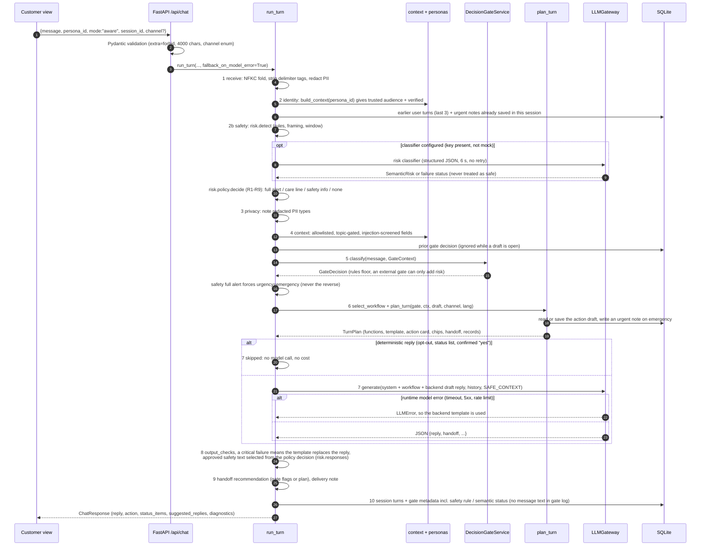
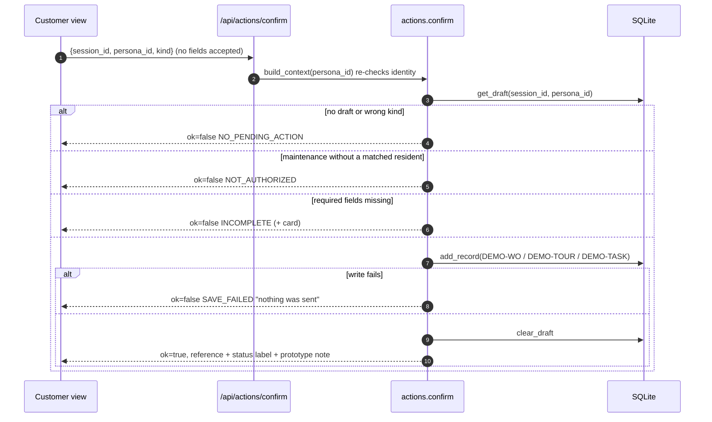

# Request / response sequence

Matches `run_turn` in `backend/app/chat_engine.py` and `plan_turn` / `confirm` in `backend/app/actions.py`. Step numbers match the `pipeline` trace shown in the staff console.

## One chat turn: `POST /api/chat`

## Confirming a card: `POST /api/actions/confirm`

