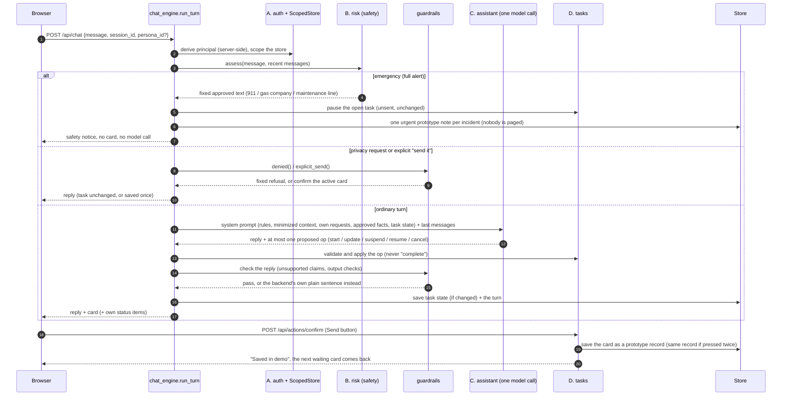

# One chat turn, and the Send button

The simplified MVP (`backend/app/chat_engine.py`, `run_turn`). The pre-MVP 11-step version is archived in
[../archive/pre-mvp/diagrams/chat-turn-sequence.md](../archive/pre-mvp/diagrams/chat-turn-sequence.md).

After a grounded resolution of an emergency ("the gas company fixed the leak"), the incident closes, a calm line
replaces the alert, and the paused card comes back exactly as it was. A vague "it's fine now", or danger still
present, keeps the incident open. Details: [safety-architecture.md](safety-architecture.md).
