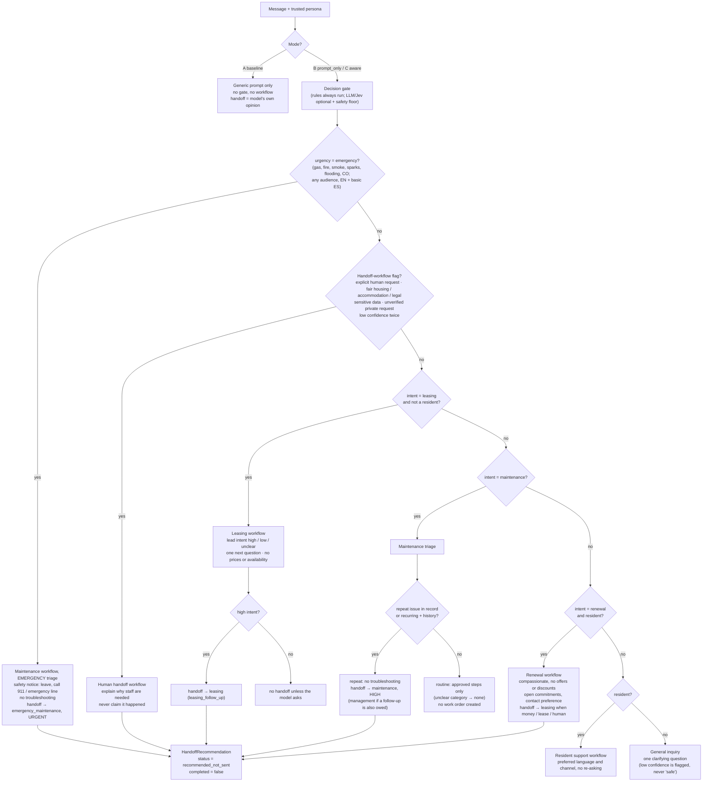

# Conversation flow: gate → workflow → handoff

Mirrors `select_workflow` (`backend/app/workflows.py`), `classify_rules` (`backend/app/gates/rules.py`) and
`build_handoff` (`backend/app/handoff.py`). The order of the checks matters: the first matching branch wins.

Notes:
- A *soft* request ("can someone explain my choices?") sets `human_requested`, so a handoff is still recommended, but the conversation stays in the more specific workflow (for example renewal). Only an *explicit* request ("real person", "not a bot") switches to the human handoff workflow.
- Any always-human flag forces `requires_human` (see `ALWAYS_HUMAN_FLAGS` in `backend/app/gates/base.py`). If the response model recommends a handoff on its own, that also produces a recommendation.
