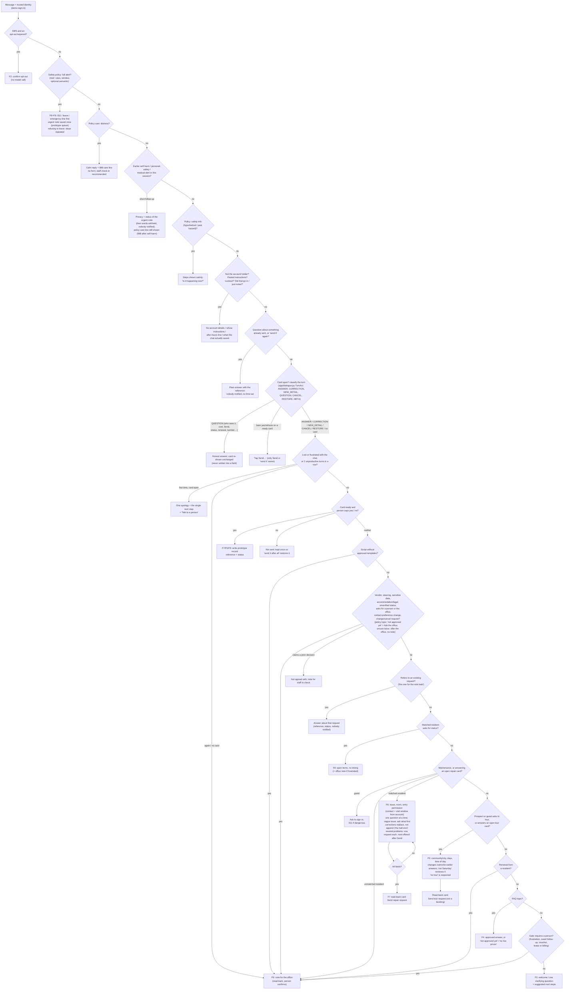
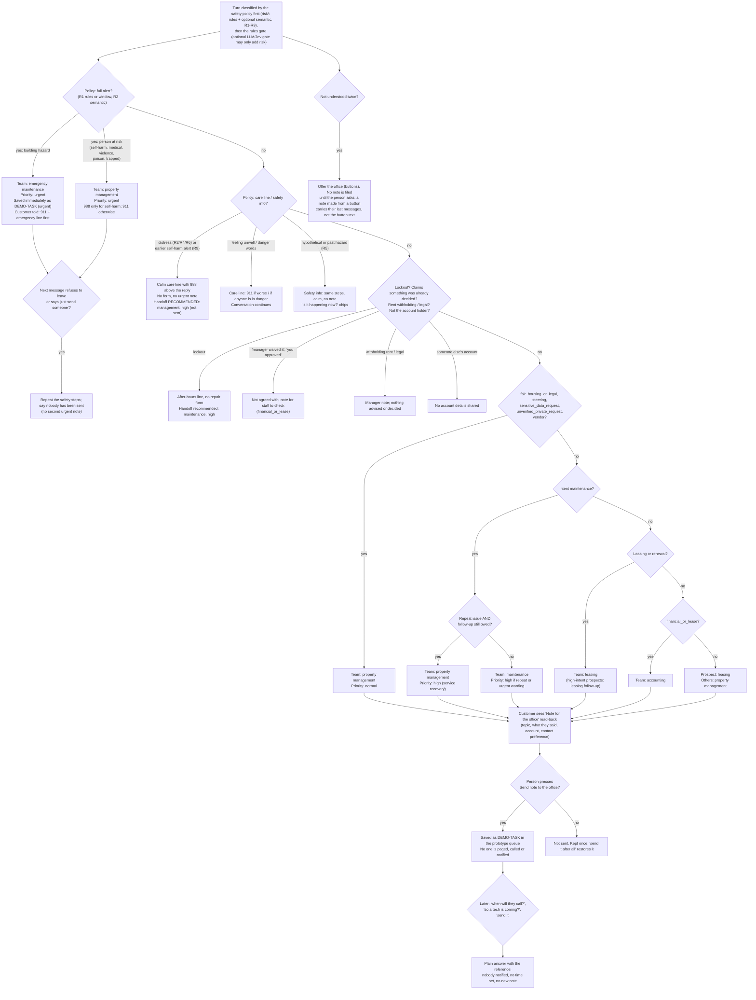

# Conversation routing

Two views of `actions.plan_turn`: the order of checks (section 1) and who receives a note (section 2).

## 1. Order of checks (F1–F9 as implemented)

The order of checks in `actions.plan_turn`. Earlier checks win. Every branch ends in either an answer, one question, a read-back card the person must confirm, or a note for the office.

Not shown because they're not built: F1 voice (rejected at the API), real verification (I-10), live calendar slots (D-09), notifications (D-13).

## 2. Handoff: who gets a note, at what priority

Who gets a note, at what priority, and how it's delivered. Built from `risk/policy.py`, `risk/escalation.py`, `gates/rules.py`, `gates/policy.py`, `handoff.py` and `actions.py`. A model can **add** reasons to hand off; it can never remove one.

Always-human flags (`gates/base.ALWAYS_HUMAN_FLAGS`): emergency_hazard, human_requested, sensitive_data_request, fair_housing_or_legal, financial_or_lease, voucher_eligibility, unverified_private_request, context_repeat_issue, context_open_commitment, repeat_with_history, repeated_low_confidence, complaint_or_frustration.

Routing (I-26) and response times (I-05) are team drafts. Customers are never promised when someone will respond.
