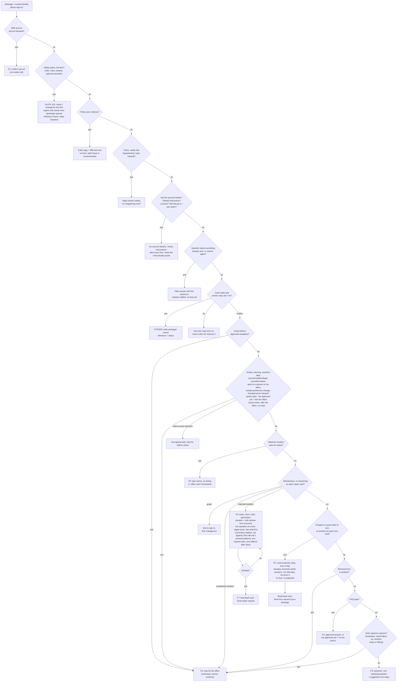

# Customer workflows (F1–F9 as implemented)

The order of checks in `actions.plan_turn`. Earlier checks win. Every branch ends in either an answer, one question, a read-back card the person must confirm, or a note for the office.

Not shown because they're not built: F1 voice (rejected at the API), real verification (I-10), live calendar slots (D-09), notifications (D-13).
