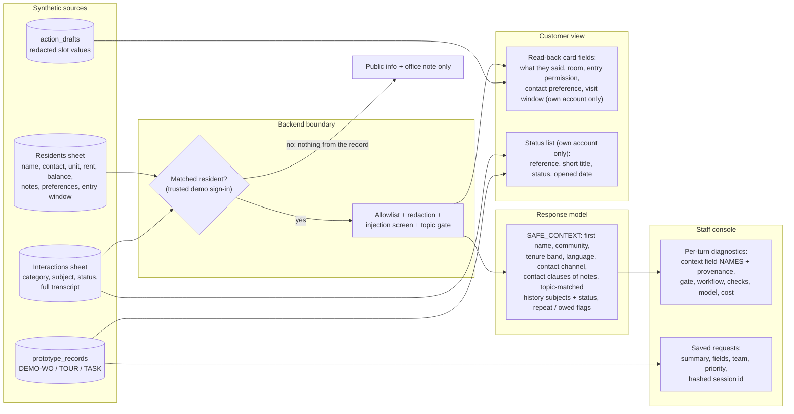

# Data access: who can see what

What flows from the synthetic workbook and the prototype store to the model, the customer and staff. Anything not listed is withheld (`context.NEVER_FORWARDED`).

Never forwarded anywhere: last name, email, phone, unit type, rent, balance, late payments, autopay, household, roommates, vehicles, pets, lead source, default entry permission, raw staff notes, interaction transcripts.

Known prototype limitations

- **Identity is a demo selector.** The browser sends `persona_id`; production must bind identity to an authenticated session server-side (I-10, I-11).
- **Staff notes contain a redacted snippet of what the person typed** (max 160 characters), because staff need it to avoid asking again. It is redacted for email, phone, SSN, card and DOB patterns.
- **The static snapshot** contains only the minimized fields above, for synthetic personas.
