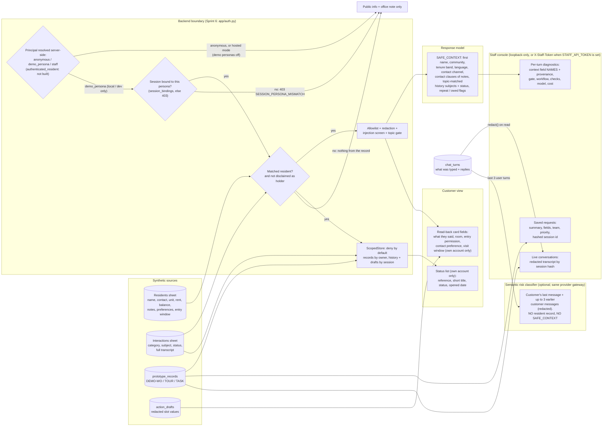

# Data access: who can see what

What flows from the synthetic workbook and the prototype store to the model, the customer and staff. Anything not listed is withheld (`context.NEVER_FORWARDED`).

Never forwarded anywhere: last name, email, phone, unit type, rent, balance, late payments, autopay, household, roommates, vehicles, pets, lead source, default entry permission, raw staff notes, interaction transcripts.

Known prototype limitations

- **Identity is a demo selector, now behind a server-side principal (Sprint 6).** The browser still picks `persona_id`, but only a `demo_persona` principal may use it, a session is bound to its first persona, and the data layer (`ScopedStore`) refuses anything else. Hosted mode turns demo personas off, so a public deployment serves public information only. A demo persona is **not** authentication; production must add real sign-in that produces `authenticated_resident` (I-10, I-11). See [../security/AUTHORIZATION_BOUNDARIES.md](../security/AUTHORIZATION_BOUNDARIES.md).
- **Staff notes contain a redacted snippet of what the person typed** (max 240 characters; when the note was created from a button, the person's last three messages), because staff need it to avoid asking again. It is redacted for email, phone, SSN, card number, card expiry/CVV and DOB patterns.
- **The staff boundary is demo-only.** Without `STAFF_API_TOKEN`, staff, evaluation, gate and records routes answer only direct requests from this machine; since sprint 3 any proxy-forwarding header (X-Forwarded-For, X-Real-IP, Forwarded, Via, ...) makes the request non-local. A shared deployment must still set a token, and real staff sign-in is still required.
- **The safety decision is visible to staff only** (`risk` on each response: rule, layers, conflict, degraded). The customer sees only the approved safety text.
- **The static snapshot** contains only the minimized fields above, for synthetic personas.
