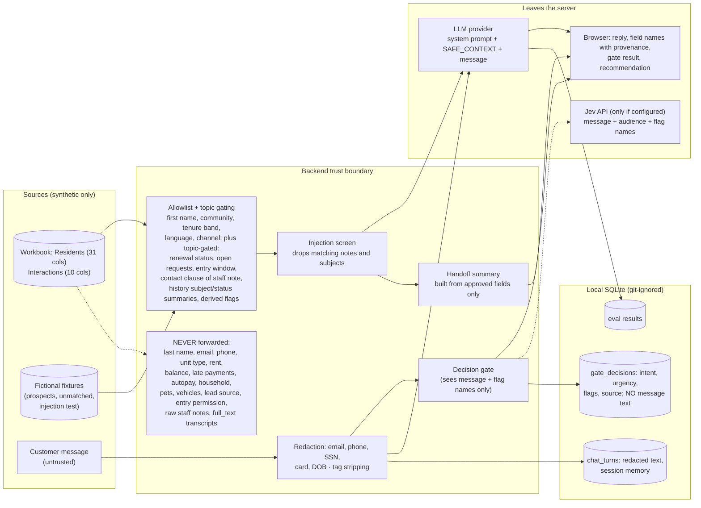

# Data flow and privacy boundaries

Mirrors `backend/app/context.py` (allowlist, `NEVER_FORWARDED`), `backend/app/safety.py` (redaction and injection screen) and `backend/app/db.py`.

| Boundary | Rule | Where enforced |
|---|---|---|
| Identity | Audience and verification come from the demo persona only; models cannot change them | `chat_engine.py` step 2, `gates/policy.py` |
| Mode B (prompt_only) | No resident fields reach the model or the gate's record flags | `chat_engine.identity_only` |
| Free hosted models | Synthetic or de-identified data only; free endpoints may log prompts | `docs/ENGINEERING_RULES.md` |
| Static demo snapshot | Contains only minimized SAFE_CONTEXT values (same as UI), no raw rows | `export_demo.py` |
| Keys | Server-side `backend/.env` only; never in responses or the static site | `config.py`, tests in `test_api.py` |
