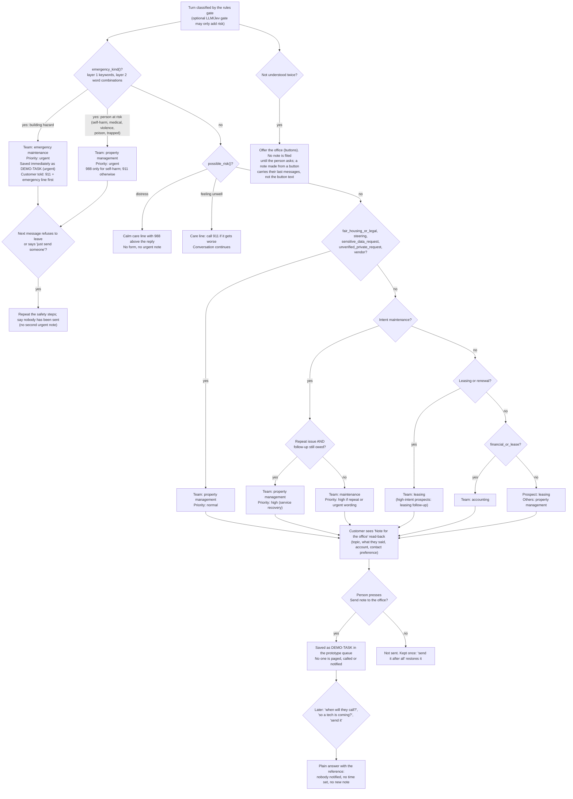

# Handoff decision tree

Who gets a note, at what priority, and how it's delivered. Built from `gates/rules.py`, `gates/policy.py`, `handoff.py` and `actions.py`. A model can **add** reasons to hand off; it can never remove one.

Always-human flags (`gates/base.ALWAYS_HUMAN_FLAGS`): emergency_hazard, human_requested, sensitive_data_request, fair_housing_or_legal, financial_or_lease, voucher_eligibility, unverified_private_request, context_repeat_issue, context_open_commitment, repeat_with_history, repeated_low_confidence, complaint_or_frustration.

Routing (I-26) and response times (I-05) are team drafts. Customers are never promised when someone will respond.
