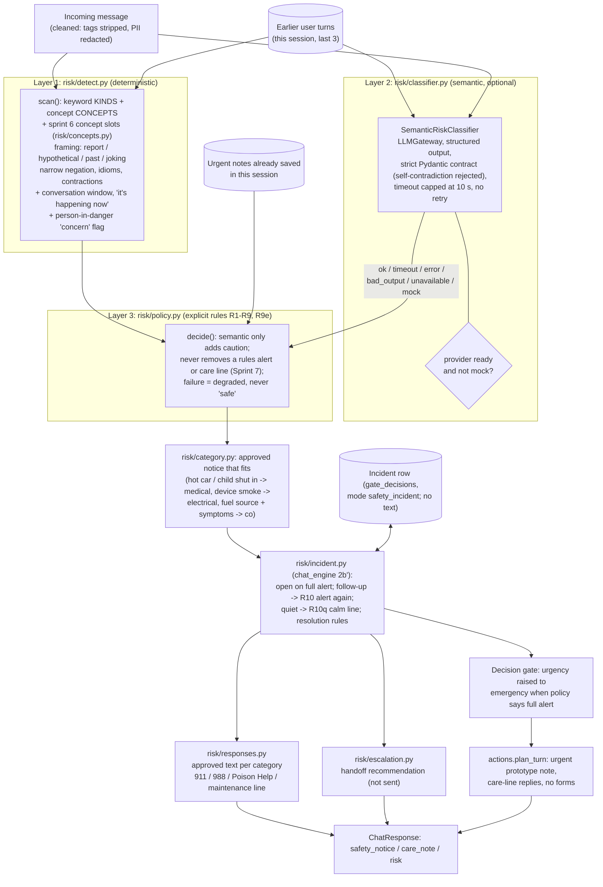
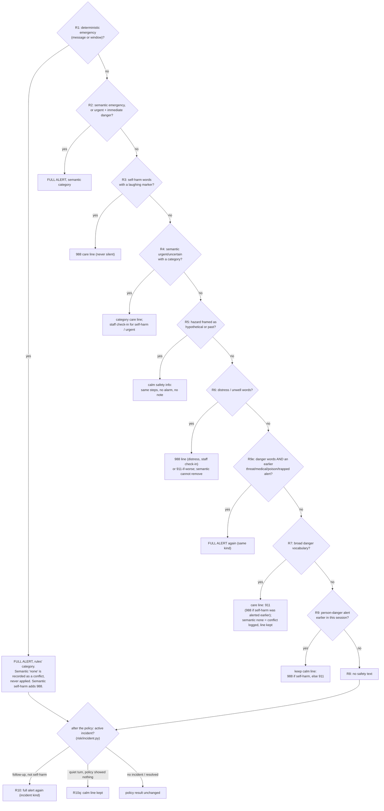

# Safety architecture (sprint 3, updated sprint 6)

Reflects `backend/app/risk/` and its use in `backend/app/chat_engine.py` on `feat/workflow-customer-experience`.
Safety is decided **before** routing and before any response generation, and no later step (the response model,
the customer's instructions or retrieved records) can lower it. The safety text is fixed team-draft wording
(I-17/I-18, not McKinley-approved); no model writes it.

## 1. Layers and their separate interfaces

## 2. Conflict resolution (policy rules, first match wins)

Authoritative rule table with conditions: [safety-evaluation.md §2](../safety/safety-evaluation.md).

The normal-versus-emergency sequence is part of [chat-turn-sequence.md](chat-turn-sequence.md) (step 2b).

Sprint 6 live check (6 calls, `openrouter:nvidia/nemotron-3.5-super-vl:free`): 3 valid structured answers, 3
timeouts at 6 s (recorded as degraded; the rules alone decided). The semantic layer is therefore **not reliable
enough to carry recall** on this model. See [SAFETY_STATE_AND_EVALUATION.md](../safety/SAFETY_STATE_AND_EVALUATION.md).
The incident state machine diagram is in the same document.
