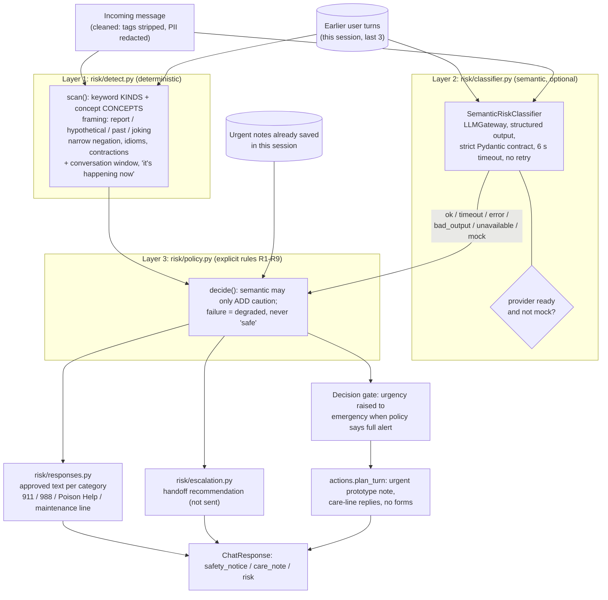
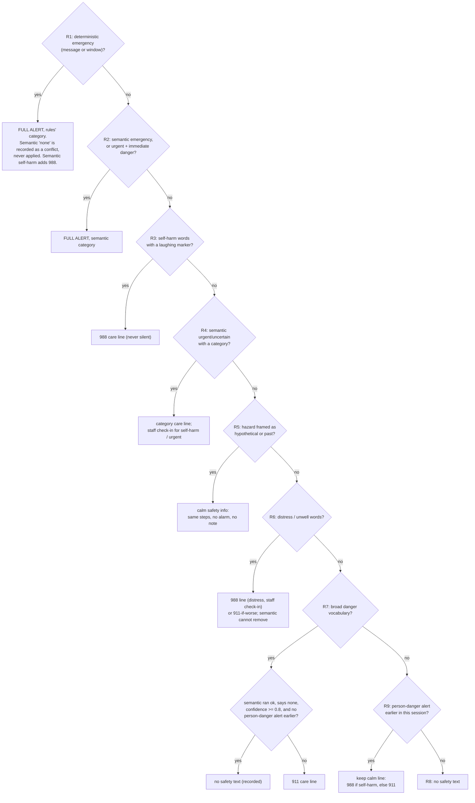
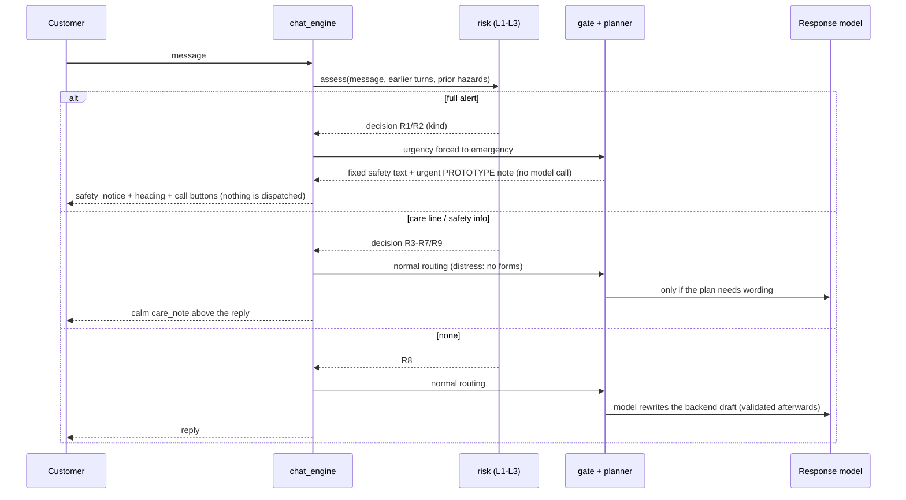

# Safety architecture (sprint 3)

Reflects `backend/app/risk/` and its use in `backend/app/chat_engine.py` on `feat/workflow-customer-experience`.
Safety is decided **before** routing and before any response generation, and no later step (the response model,
the customer's instructions or retrieved records) can lower it. The safety text is fixed team-draft wording
(I-17/I-18, not McKinley-approved); no model writes it.

## 1. Layers and their separate interfaces

## 2. Conflict resolution (policy rules, first match wins)

## 3. Normal versus emergency path

The semantic classifier is **not live-verified**: in this environment no provider key exists, so every turn is
recorded as `semantic.status = mock | unavailable` and `decision.degraded = true`, and safety rests on layer 1 + the
policy alone. See `docs/SAFETY_EVALUATION.md`.
