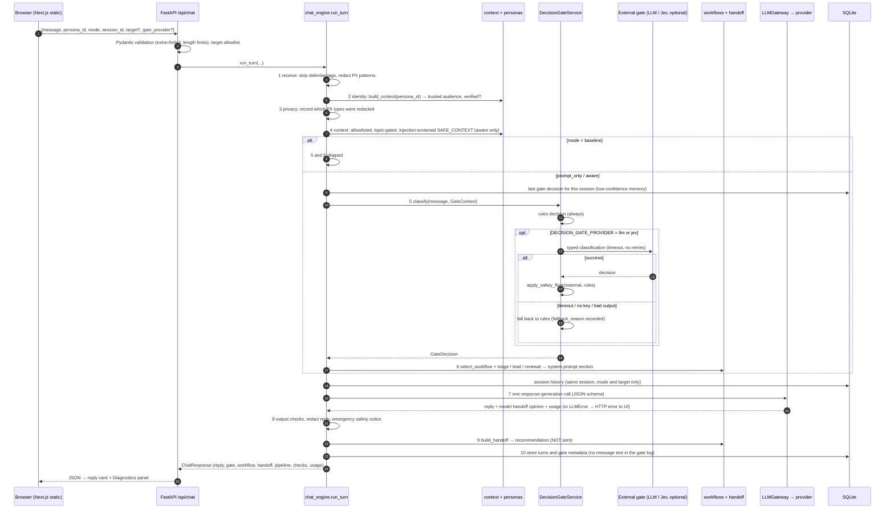

# Request / response sequence (`POST /api/chat`)

Matches `run_turn` in `backend/app/chat_engine.py`. Step numbers match the `pipeline` trace returned to the UI.

If the backend is unreachable (as on the hosted static site), the UI loads `/demo/snapshot.json` instead and labels every response as pre-computed MOCK output.
