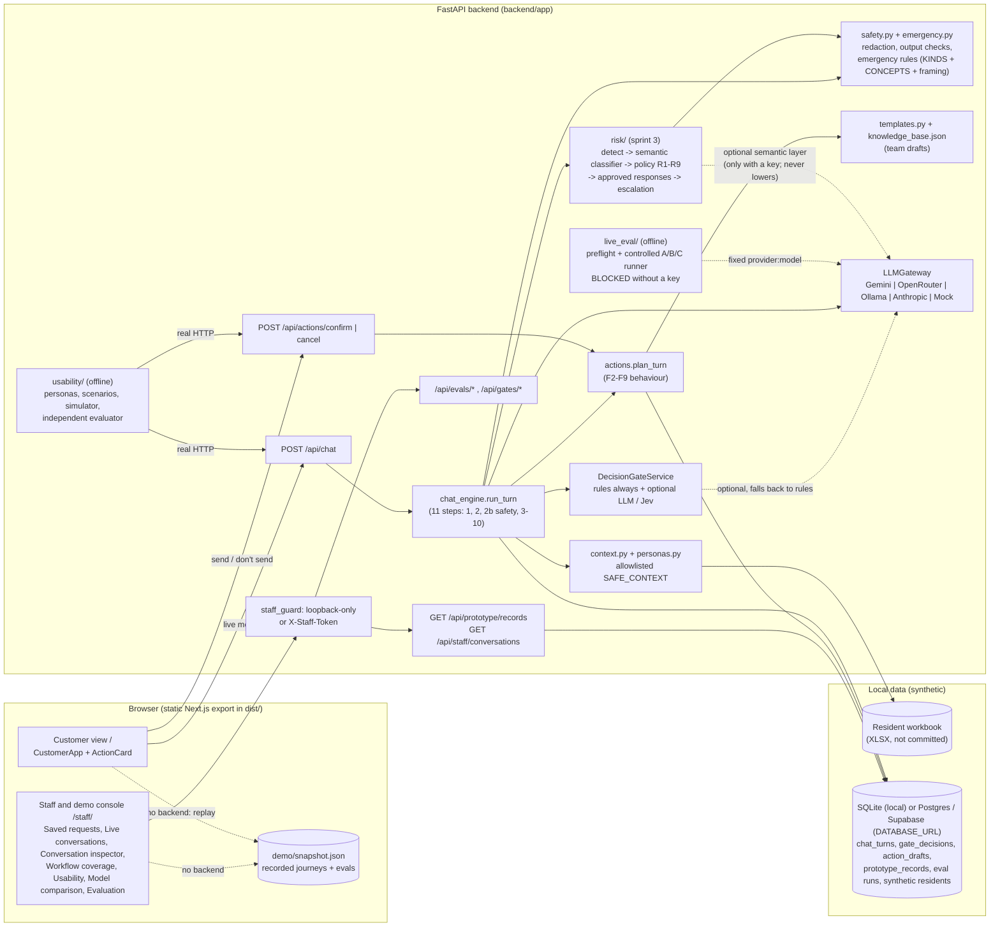
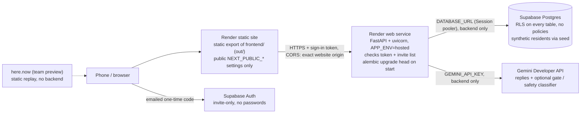
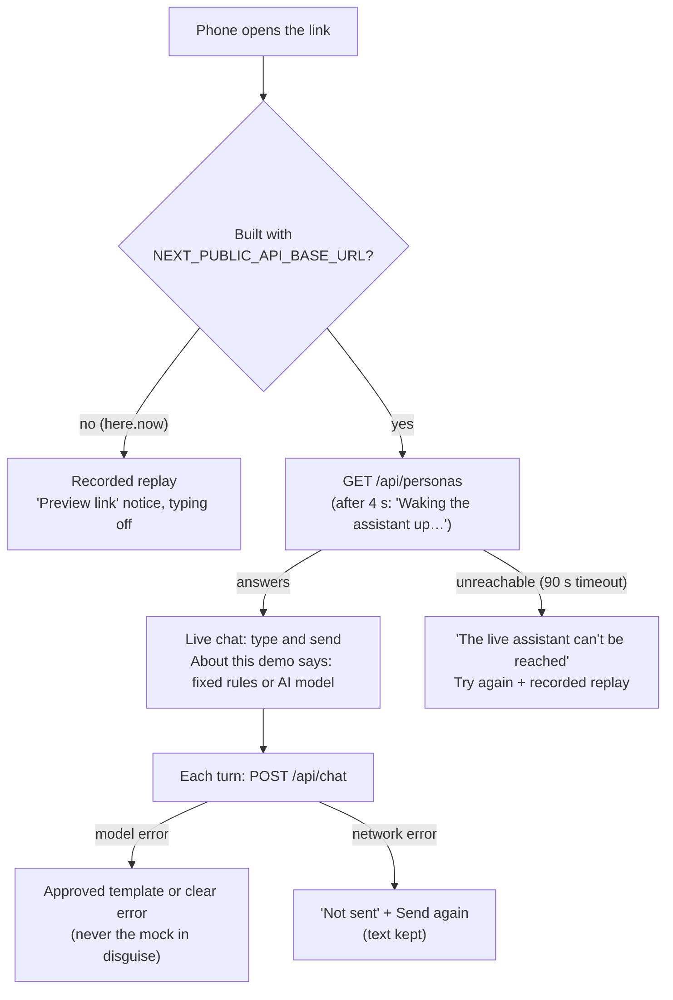

# System architecture

Reflects the code on `feat/gemini-supabase-deployment`. Two front-ends share one static build; the Python API is the only place with resident data, model keys or business rules.

Notes

- **here.now hosts only `dist/`.** On the preview link there is no backend, so both views fall back to `demo/snapshot.json`, which `uv run python -m app.export_demo` records by running the real pipeline (mock model, rules gate) over 17 multi-turn journeys.
- **Providers never receive workbook rows.** They get the system prompt, trusted workflow instructions, a backend draft reply and the minimized SAFE_CONTEXT block.
- **Safety runs first** (`risk/`, see `safety-architecture.md`): its decision can only raise the gate's urgency. The
  semantic classifier receives only the customer's last message and up to three earlier customer messages (never
  resident records). Without a provider key it does not run and every turn is marked `degraded`.
- **Prototype store ≠ Yardi.** `prototype_records` stands in for work orders (D-11), CRM tour requests (D-10) and the staff queue (D-14). Nothing leaves SQLite.

## Target deployment (prepared, not yet deployed)

Secrets (`GEMINI_API_KEY`, `DATABASE_URL`, `STAFF_API_TOKEN`, a legacy `SUPABASE_JWT_SECRET`) live only in Render's
settings. The browser talks to Supabase **only** to sign in (public project address and publishable key) and never to
Supabase's database or to Gemini. The backend decides who someone is ([../security/SUPABASE_AUTH.md](../security/SUPABASE_AUTH.md)). Status and checklist: [../DEPLOYMENT_READINESS.md](../DEPLOYMENT_READINESS.md).

## What the customer page shows (no silent substitution)

Layout on a phone, top to bottom:
- the blue McKinley band;
- the demo row (Demo sign-in select and About this demo), which scrolls away;
- the conversation;
- the composer, pinned at every height and lifted above the keyboard (`visualViewport` on iOS,
  `interactive-widget=resizes-content` on Android). It holds the suggestions, the message box with Send, then
  Talk to a person, Start over and Call 911.

Details: [../design/BRAND_SYSTEM.md](../design/BRAND_SYSTEM.md), [../design/MOBILE_UX_AUDIT.md](../design/MOBILE_UX_AUDIT.md).
