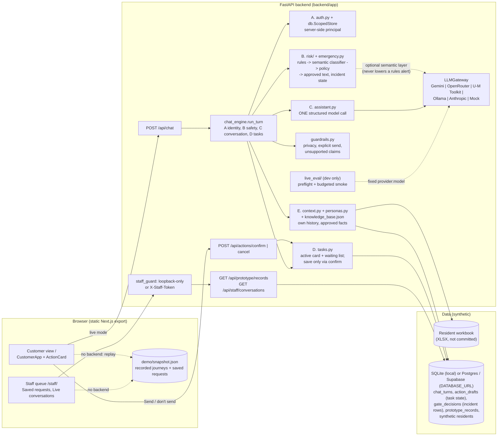
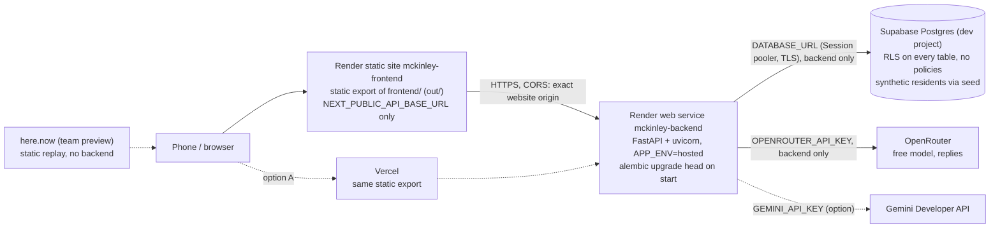
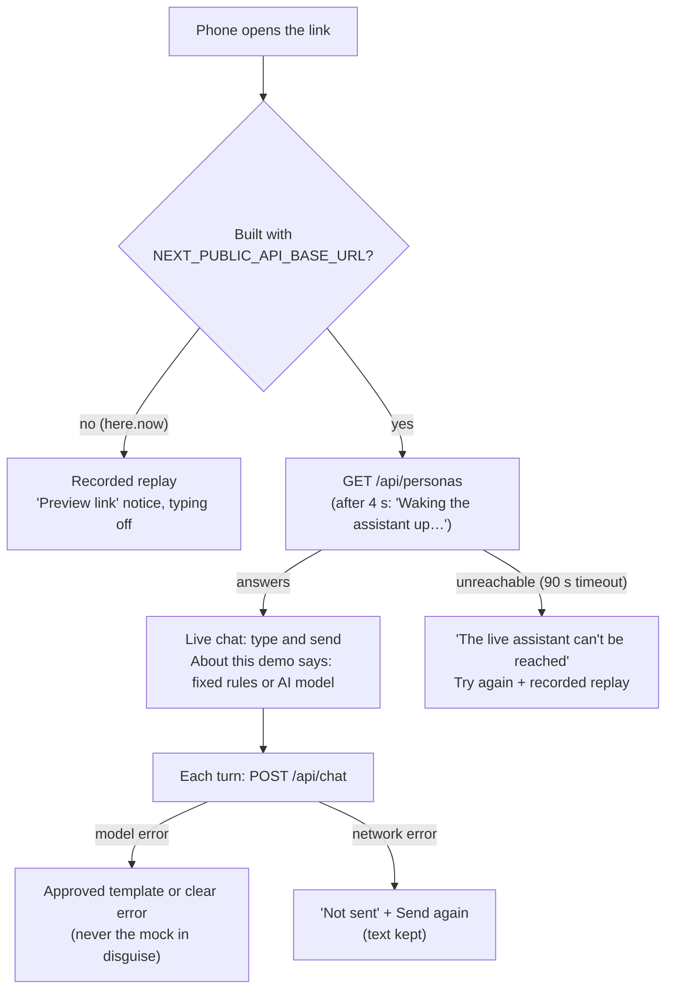

# System architecture

Reflects the simplified MVP (`mvp-reset`). Two front-ends share one static build; the Python API is the only place with resident data, model keys or business rules.

Notes

- **here.now hosts only `dist/`.** On the preview link there is no backend, so both views fall back to `demo/snapshot.json`, which `uv run python -m app.export_demo` records by running the real pipeline on the MOCK model over the recorded multi-turn journeys.
- **Providers never receive workbook rows.** The one conversation call gets the system prompt (rules, the minimized SAFE_CONTEXT block, the person's own requests, approved property facts, the task state) and the last few messages.
- **Safety runs first** (`risk/`, see `safety-architecture.md`): an emergency answers with fixed approved text and pauses the open task, with no conversation model call. The
  semantic classifier receives only the customer's last message and up to three earlier customer messages (never
  resident records). Without a provider key it does not run and the rules alone decide.
- **Prototype store ≠ Yardi.** `prototype_records` stands in for work orders (D-11), CRM tour requests (D-10) and the staff queue (D-14). Nothing leaves the prototype database.

## Deployment (live public demo since 2026-11-11; option B)

Secrets (`OPENROUTER_API_KEY`, `GEMINI_API_KEY`, `DATABASE_URL`, `STAFF_API_TOKEN`) live only in Render's settings.
The browser never talks to Supabase or the model provider. Status and checklist: [../DEPLOYMENT_READINESS.md](../DEPLOYMENT_READINESS.md).

## What the customer page shows (no silent substitution)

Layout on a phone, top to bottom:
- the blue McKinley band;
- the demo row (Demo sign-in select and About this demo), which scrolls away;
- the conversation;
- the composer, pinned at every height and lifted above the keyboard (`visualViewport` on iOS,
  `interactive-widget=resizes-content` on Android). It holds the suggestions, the message box with Send, then
  Talk to a person, Start over and Call 911.

Details: [../design/BRAND_SYSTEM.md](../design/BRAND_SYSTEM.md), [../design/MOBILE_UX_AUDIT.md](../design/MOBILE_UX_AUDIT.md).
