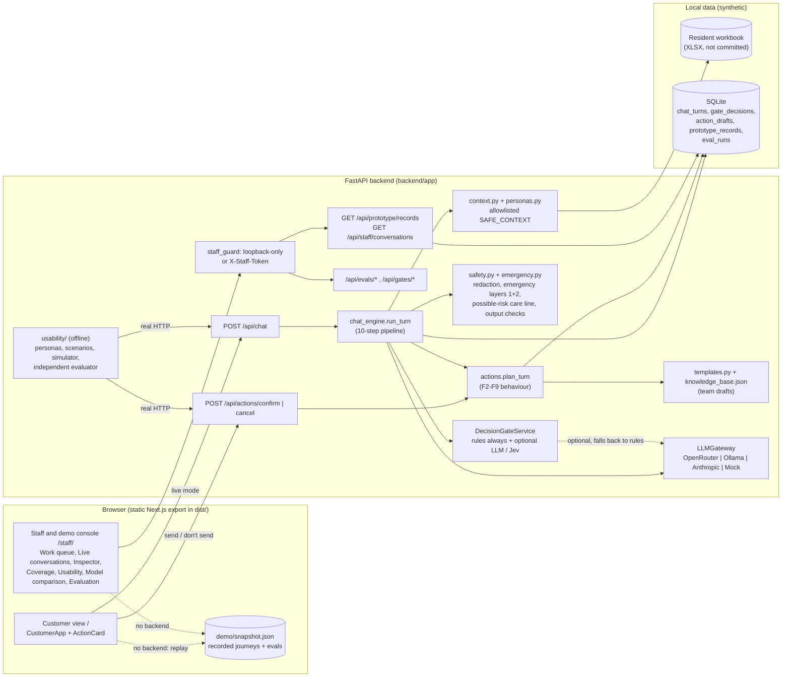

# System architecture

Reflects the code on `feat/workflow-customer-experience`. Two front-ends share one static build; the Python API is the only place with resident data, model keys or business rules.

Notes

- **here.now hosts only `dist/`.** On the preview link there is no backend, so both views fall back to `demo/snapshot.json`, which `uv run python -m app.export_demo` records by running the real pipeline (mock model, rules gate) over 17 multi-turn journeys.
- **Providers never receive workbook rows.** They get the system prompt, trusted workflow instructions, a backend draft reply and the minimized SAFE_CONTEXT block.
- **Prototype store ≠ Yardi.** `prototype_records` stands in for work orders (D-11), CRM tour requests (D-10) and the staff queue (D-14). Nothing leaves SQLite.
